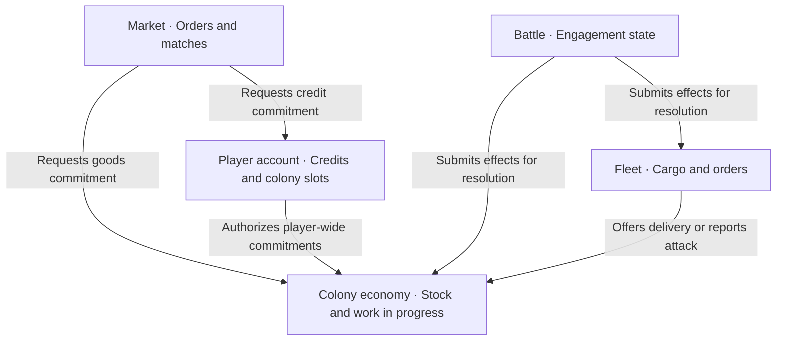

# Building Block View

[Architecture overview](README.md) · [Runtime view](runtime.md) · [Deployment view](deployment.md)

## Candidate consistency boundaries

**Proposed · [#37](https://github.com/bwoester/cold-frontier/issues/37).** A consistency boundary groups writes that must succeed or fail together to preserve a gameplay rule. The state names below are candidates. Each arrow names a dependency to examine in a runtime scenario.

| Example | Candidate owner and invariant | Open question |
| --- | --- | --- |
| Start a build or a recipe with the last unit of local stock | Colony economy. The same unit cannot fund both actions. | Which local state changes accompany each withdrawal, and which action has priority? |
| Two flights compete for the last colony slot | Player account or a player-wide colonization authority. Only one attempt gets the slot. | When is a slot committed, and who releases it if the target is lost? |
| Two robot miners compete for one deposit | The authority that owns the deposit must prevent over-extraction. | Does a planet, asteroid, or independent deposit own that state? When does fleet cargo become available? |
| A battle station is requested by simultaneous engagements | If exclusive participation is a game rule, its owner must enforce it. | Can a station join both, who commits it, and when? |
| Market order uses local goods and player-wide credits | The respective owners prevent double commitment of their assets. | What can a player observe while those commitments are pending? |

The [resource simulation contract](resource-simulation-contract.md#responsibilities-when-adding-other-game-mechanics) proposes that mechanics determine their own effects, coordination establishes when they apply, and the affected authority applies its state changes. [#38](https://github.com/bwoester/cold-frontier/issues/38) tracks concrete handoffs and retries. See the [unloading runtime example](runtime.md#unloading-and-same-time-actions).

**Implemented on main.** The Java prototype has a global tick coordinator, a planet that calls production and accounting, and separate player and planet accounts. These are observed collaborators. The [prototype notes](current-state.md) also record that writes in the observed flow lack a shared transaction.
