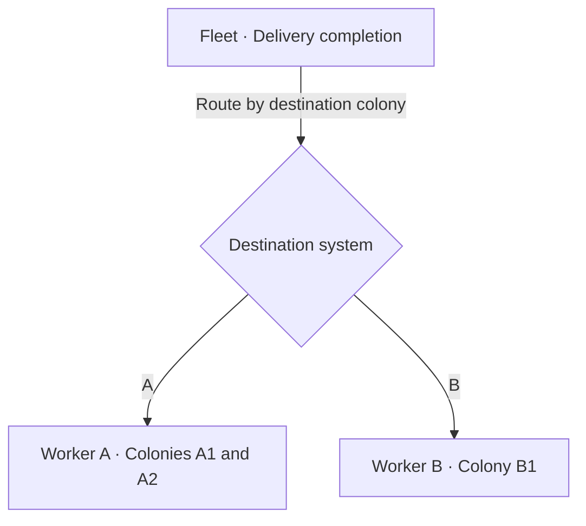

# Deployment View

[Architecture overview](README.md) · [Candidate consistency boundaries](building-blocks.md)

## Horizontal placement variants

**Proposed · [#39](https://github.com/bwoester/cold-frontier/issues/39).** Compare a single deployment with placement across workers. The building block view addresses which authority can change state. Placement determines where that authority runs and how participants reach it.

**Geographic placement example.** Two colonies in the same solar system share a worker. An inter-system delivery crosses worker boundaries. Fleet processing can be colocated or assigned its own worker. With a separate fleet worker, even a delivery within one system can require a network handoff to the destination worker.

| Variant | What stays local | Cost or question |
| --- | --- | --- |
| **Single deployment baseline** | All gameplay authorities can call each other in process. | Establish throughput and latency before distributing work. State ownership still governs each update. |
| **Solar system or galaxy** | Interactions inside the selected geographic group, if their participants are colocated. | Cross-group actions need routing. A popular system or galaxy can overload one worker. |
| **Player or alliance** | Interactions within an affiliation, if enough occur there. | Cross-owner attacks and trade cross groups. Ownership and alliance changes may shift placement or reduce locality. |
| **Measured interactions** | Frequently interacting authorities can be grouped close together. | Measurements can go stale. Reassignments must justify their cost and keep commands and due effects routed correctly. |
| **Separate fleet, battle, or market workers** | Each mechanic can scale its own work independently where that work permits. This can be combined with geographic or other placement. | Their effects still go through the relevant state owner. A contested stock or deposit can remain a bottleneck. |

## Quality scenarios

| Stimulus | Measure and compare |
| --- | --- |
| Normal construction and production across many colonies | Baseline throughput, peak load per worker, and the fraction of operations that leave the worker. |
| An illustrative burst of 100 arrivals and several attacks in one system over five game minutes | Peak load, cross-worker coordination, and wall-clock delay beyond when actions are due. Use actual player or load-test data to define success thresholds. |
| An alliance changes while transports are in flight | Whether arrivals still reach the current authority, the time needed for reassignment, and whether retries or concurrent writes can duplicate effects. |
| Market volume increases while colony traffic stays flat | Market throughput and delay in stock and credit commitments. Compare shared placement with separate workers. |

The first cross-worker case can reuse the [unloading example](runtime.md#unloading-and-same-time-actions). Before selecting a layout, establish how it preserves the same stock outcome and effective game time when the destination accepts a delivery but its response is lost.
