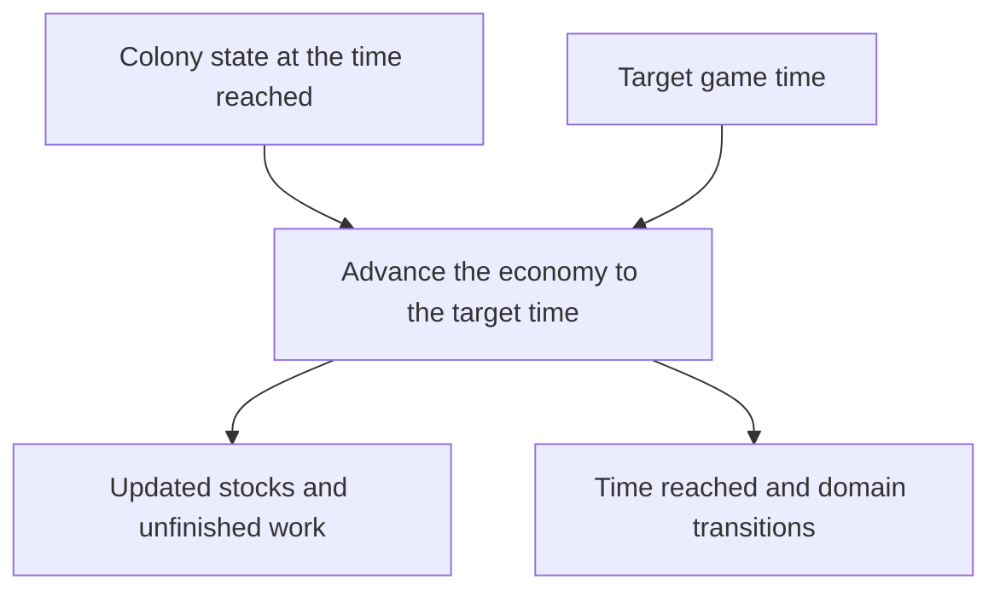
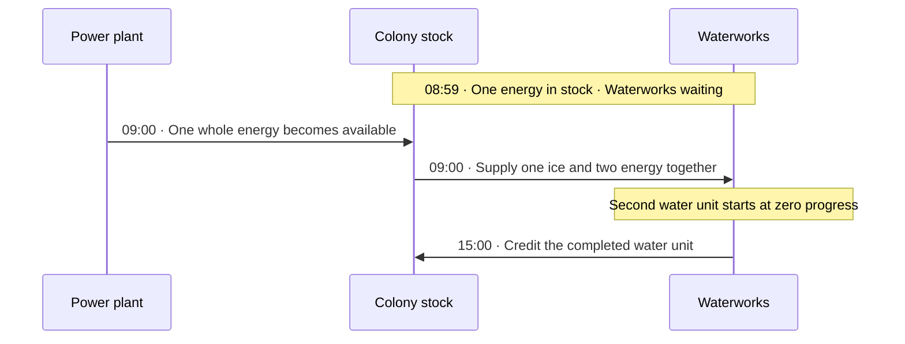
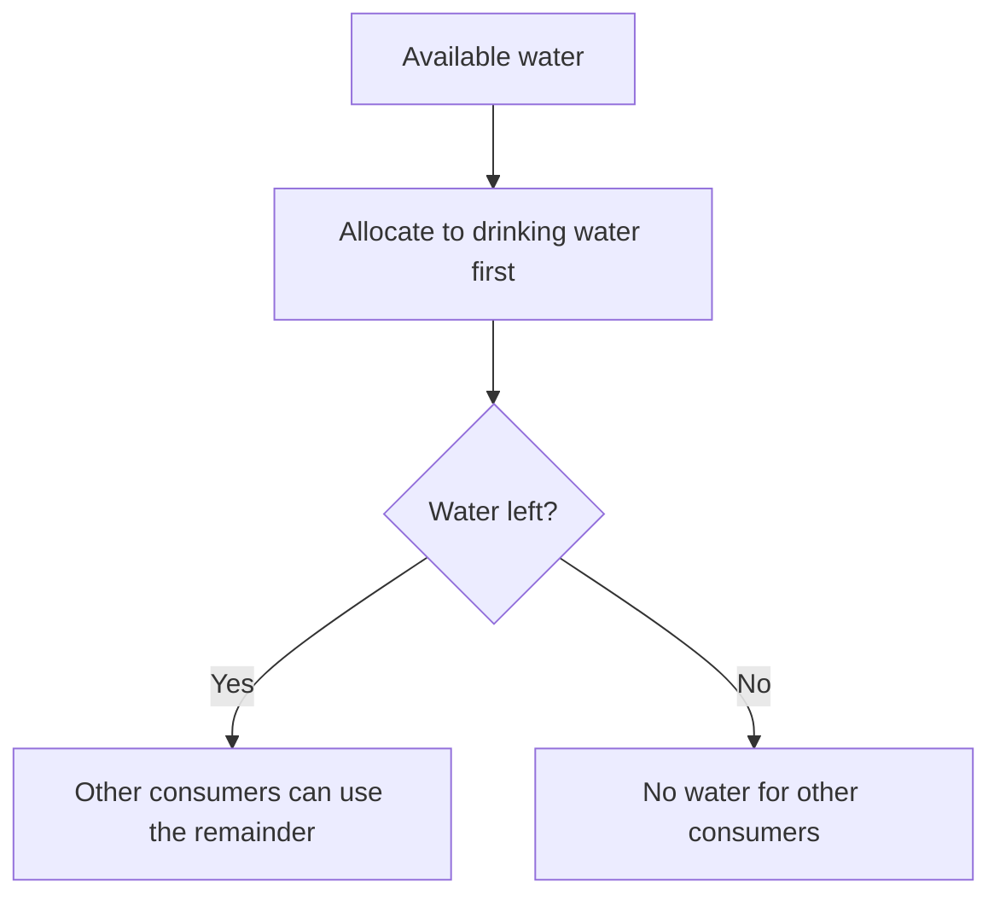
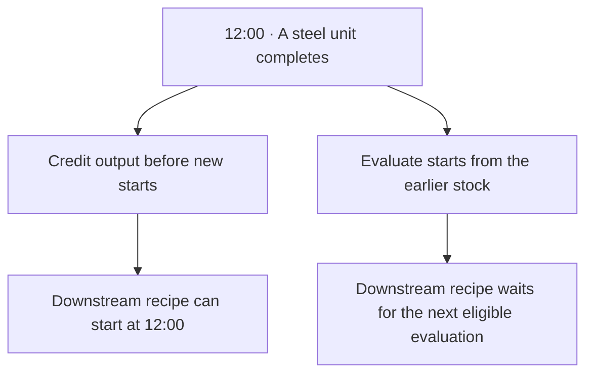
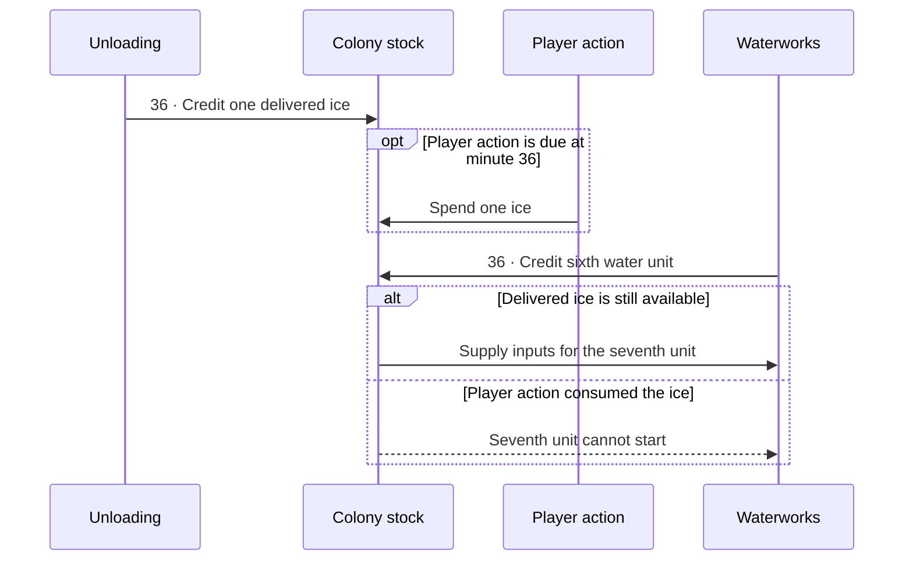
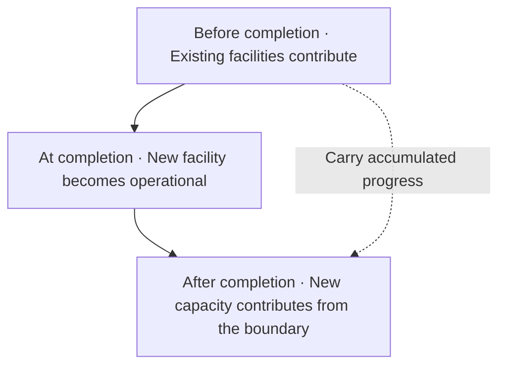

# Runtime View

[Architecture overview](README.md) · [Domain contract](resource-simulation-contract.md) · [Building block view](building-blocks.md)

## Advancing the colony economy

**Proposed domain contract.** Advancing a colony from one game time to another takes its current state and the target time. Its result carries the updated state and the time reached. Reporting domain transitions with their effective times is part of the proposal. The [resource simulation contract](resource-simulation-contract.md#stage-1) specifies the details.

**Implemented on main.** The [tick coordinator](../../lib/src/main/java/de/bwoester/coldfrontier/TickCoordinator.java) runs input, resource updates and then construction completions across registered components. In the [planet resource update](../../lib/src/main/java/de/bwoester/coldfrontier/planet/Planet.java), the prototype calculates rate-based production and books whole quantities before advancing configured recipes. The [phase table](resource-simulation-contract.md#phase-order-of-the-tick-prototype) covers the rest of the tick. Phase order is observable prototype behavior. The gameplay order for competing inputs remains [open](command-ordering.md).

**Decided.** Whole mined units can supply recipes at the same game time. A recipe takes a complete set of inputs together on start and retains progress until its output is complete. See [pooled processing](../game-design/economy.md#pooled-processing-per-colony-and-recipe).

**In review.** [PR #35](https://github.com/bwoester/cold-frontier/pull/35) exercises local energy production and distinguishes elapsed recipe work from new recipe starts at the closing time. The following is the PR's waterworks scenario. At 09:00 the newly produced unit joins one unit of energy already in stock.

## Water allocation

**Decided.** Available water first covers the current population's drinking-water demand. Other consumers may use the remainder. The priority applies to water already available. See [water shortages](../game-design/economy.md#priority-during-water-shortages).

**Open · [#30](https://github.com/bwoester/cold-frontier/issues/30).** When does freshly completed water enter this allocation? How far does priority extend upstream when waterworks and industry compete for labor, ice, or energy? The example in #30 starts with an empty stock and one water unit finishing exactly when residents and cooling each demand one.

| Proposed timing | Consequence in the example |
| --- | --- |
| Credit completed water before allocating demand due at that time. | Residents receive the unit immediately. Cooling receives none. |
| Allocate only from the stock visible before that completion. | Neither demand receives that unit in this allocation. The rule must define when that unit can next be allocated. |

## Same-time availability variants

**Open · [#36](https://github.com/bwoester/cold-frontier/issues/36).** A steelworks completes a whole unit at 12:00. Another recipe has its other ingredients and is waiting for that steel. Compare the outcomes before choosing which stock each recipe can see.

Both branches are proposals for this case. A common snapshot reduces dependencies on evaluation order, but its cut-off must be defined carefully. A version that also hides newly mined units would change the confirmed mining rule. [#36](https://github.com/bwoester/cold-frontier/issues/36) also tracks the overflow question. If ten units arrive at a full store and a recipe withdraws ten at the same game time, the check at delivery completion loses the shipment. Deferring the check could keep up to ten delivered units if that withdrawal succeeds. Such a variant needs a rule for what stock intervening actions can spend and would change the documented completion rule.

## Unloading and same-time actions

**Specified gameplay examples · acceptance binding pending in [#27](https://github.com/bwoester/cold-frontier/issues/27).** The [unloading scenarios](../game-design/scenarios/delivery-completion.feature) put the unloading credit ahead of the player action and the resource update in this example. The sixth water unit finishes at minute 36 either way.

**Proposed handoff responsibilities.** The fleet side owns the unloading action and the colony side applies its stock and capacity rules. A delivery of 30 ice into 10 free spaces results in 10 credited, 20 lost and none remaining aboard in the [specified scenario](../game-design/scenarios/delivery-completion.feature). The handoff protocol is open in [#38](https://github.com/bwoester/cold-frontier/issues/38).

| Proposed handoff | What the failure case requires |
| --- | --- |
| Shared atomic commit where cargo and stock can be updated together | Persist cargo removal and stock credit together. A retry after a lost response must recover the original result. |
| Separate authorities exchange a durable handoff | If acceptance is recorded but the response is lost, a retry retrieves the same outcome. The design must define when cargo becomes unavailable to other actions, what players see during recovery, and how later actions see the change at minute 36. |

## Effective game time and audit

**Decided.** Construction completion changes which facilities contribute from the effective completion time onward. Completion itself produces no resources. Already accumulated progress survives the boundary. See [construction completion](../game-design/economy.md#construction-completion-and-production-progress).

**Specified audit behavior · pending in [#18](https://github.com/bwoester/cold-frontier/issues/18).** The last ice is withdrawn at minute 30. The sixth water unit finishes at minute 36, when the seventh cannot start. The depletion event marks that transition at minute 36, even when a call advances straight to minute 60. See the [water production scenario](../game-design/scenarios/water-production.feature).

### Reproducible advancement

With the same initial state and effective actions, advancing to minute 60 directly or via minutes 30, 33 and 36 should yield the same final stock and production state. The engine must retain unfinished progress at intermediate times. The audit requirement additionally expects exactly one depletion event with effective time 36 across the full interval. The [stock and progress cases](../game-design/scenarios/water-production.feature) are enabled on main. The event cases remain pending in [#18](https://github.com/bwoester/cold-frontier/issues/18).
