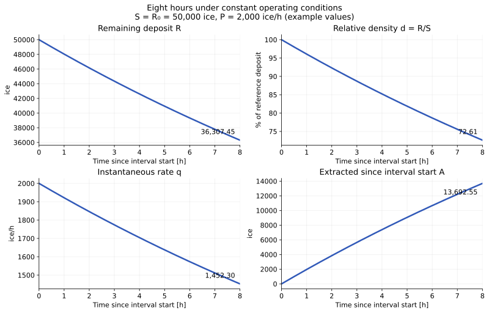
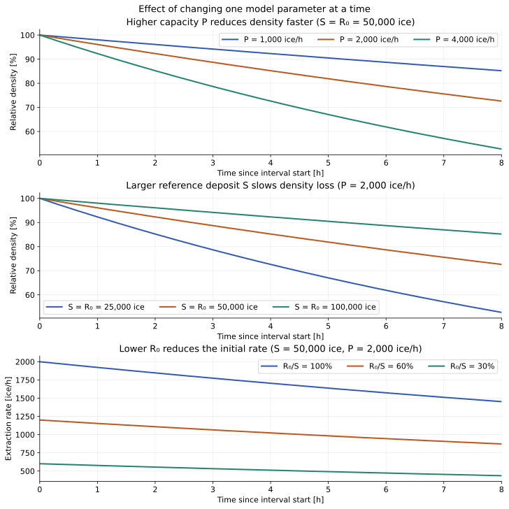
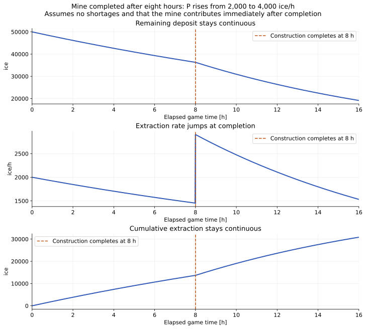

# Continuous Ice Extraction Between Events

**Status as of 2026-11-08.** The project owner wants the continuous evolution documented and considered as a mathematical model for the mechanic. The equations below follow from the proportional depletion model. Final balancing and the execution model of the full simulation remain open. In particular, this base model does not include a minimum ice yield.

## Motivation and Scope

A large mine might take around eight hours to build later in the game, or longer with modifiers (a project assumption for this example). If the relevant conditions stay the same until completion and no earlier transition occurs within the economy, it should be possible to calculate extraction directly for that interval. Eight hours corresponds to 28,800 seconds. For the depletion curve described here, one evaluation replaces 28,800 successive one-second steps.

The **extraction rate falls** throughout the interval as the deposit shrinks. The parameters governing that change remain constant. A known completion time alone cannot guarantee an uninterrupted eight-hour interval. An energy shortage could occur sooner.

The approach describes **one deposit and the quantity extracted from it**. Water production draws ice from storage. The underground deposit changes through extraction. Apply the [domain simulation contract](../architecture/resource-simulation-contract.md) to stock increases, available whole units, production in progress, and consumers.

## Starting Point: Spreadsheet and Current Model Proposal

The source is the project's earlier redesign, [RD-02 “Resource Extraction”](https://docs.google.com/spreadsheets/d/1Wng7Wi-kAfF1JS_VECUQVXRTWIYlHXlCo7YKTTP_vnA/edit). Cells A1:G12, reviewed on 2026-11-08, contain:

- 50,000 units of initial deposit in A5;
- 20 units of base extraction per mine and tick in A8;
- remaining deposit as the initial deposit minus extraction to date;
- relative density as the remaining deposit divided by the initial deposit;
- extraction as base extraction × number of mines × relative density;
- an additional mine every ten ticks in the example.

The spreadsheet documents the redesign. It establishes neither the original IceWars formula nor current building parameters. It gives no physical duration for a tick. **Converting 20 ice/tick to 20 ice/second or 20 ice/hour requires an assumption.** The hourly values below are chosen for illustration. The continuous curve is a different mathematical model from the discrete tick sequence and does not give identical results.

## Parameters and Derived Quantities

The interval starts at game time $t_0$. Let $\tau=t-t_0$ be the elapsed time.

| Symbol | Meaning | Unit or constraint |
| --- | --- | --- |
| $S$ | Fixed reference quantity of the deposit, equal to the original deposit in the spreadsheet model | ice; $S>0$ |
| $R_0$ | Remaining deposit at the beginning of **this** interval | ice; $0\le R_0\le S$ |
| $P$ | Combined extraction capacity at relative density 1, including operating modifiers that are constant in the interval | ice/h; $P\ge0$ |
| $\tau$ | Time since the start of the interval | h; $\tau\ge0$ |
| $k=P/S$ | Relative decay constant | 1/h |
| $R(\tau)$ | Deposit remaining after that time | ice |
| $d(\tau)=R(\tau)/S$ | Relative density or yield factor | Dimensionless; 0 to 1 |
| $q(\tau)=P\,d(\tau)$ | Instantaneous actual extraction rate | ice/h |
| $A(\tau)=R_0-R(\tau)$ | Quantity extracted during this interval | ice |

**S stays fixed across events.** Update only R₀ to the quantity then remaining. Resetting S to that amount would reset relative density to 1 at each event.

At P = 2,000 ice/h and a relative density of 0.6, the actual rate is 1,200 ice/h. Different mine types on the same deposit can contribute to the same P if they share a density factor and their other output parameters stay constant. Deposits with different parameters are treated separately for now.

**Relative and absolute density.** Here d = 1 means full reference yield, regardless of the planet's absolute ice content. To represent a starting absolute density such as 30%, explicitly relate it to the reference quantity and extraction capacity. That relationship remains open.

## Derivation and Direct Calculation

The deposit falls at the actual extraction rate. As the deposit shrinks, that rate decreases:

$$
\frac{dR}{d\tau}=-q(\tau)=-P\frac{R(\tau)}{S}=-kR(\tau).
$$

The solution with initial value R₀ is exponential decay:

$$
\boxed{R(\tau)=R_0\,e^{-k\tau}=R_0\,e^{-\frac{P}{S}\tau}}.
$$

This gives:

$$
d(\tau)=\frac{R_0}{S}e^{-k\tau},\qquad
q(\tau)=P\frac{R_0}{S}e^{-k\tau},\qquad
\boxed{A(\tau)=R_0\left(1-e^{-k\tau}\right)}.
$$

The exponent is dimensionless: (ice/h) / ice × h. If time is given in seconds, convert P to ice/s or divide the duration by 3,600.

A is the total extraction over the interval, the area under the q curve. Multiplying the duration by either the initial rate or the final rate gives the wrong area. The balance is always R(τ) + A(τ) = R₀.

At P = 0 the deposit is unchanged and extraction is zero. The same holds at R₀ = 0. At τ = 0 no additional extraction has occurred.

## General Form for Variable Extraction Capacity

Within the proportional model, S is fixed, d = R/S, and the actual rate is q(t) = P(t) × d(t). There are no other inflows to or outflows from the deposit during the interval. All mines share the same density factor. P(t) ≥ 0 is their capacity at full reference yield after all other operating modifiers, before applying the density reduction that yields q(t).

For a known P(t) that is integrable over the interval:

$$
\frac{dR}{dt}=-\frac{P(t)}{S}R(t),\qquad
\boxed{R(t_1)=R(t_0)\exp\left(-\frac{1}{S}\int_{t_0}^{t_1}P(u)\,du\right)}.
$$

This gives d(t₁) = R(t₁)/S, q(t₁) = P(t₁)d(t₁), and A = R(t₀) − R(t₁). At a jump in P, use the rate immediately before or after the event as appropriate. The deposit is continuous unless the event itself changes its quantity.

| Expression | Meaning | Unit with time in hours |
| --- | --- | --- |
| t₀, t₁ | Start and end of the interval | h |
| u | Integration variable spanning the interval | h |
| P(u) | Reference capacity of all mines at that time, before adjusting for density | ice/h |
| H = ∫ P(u) du | Cumulative potential extraction at relative density 1 | ice |
| H/S | Cumulative extraction pressure relative to the reference deposit | Dimensionless |

The integral sums **potential extraction**. Actual extraction A is generally smaller than H because density declines. The equation includes the feedback: extraction reduces R and d, decreasing q and slowing further extraction. **Declining density alone requires neither events for individual units nor numerical one-second steps.**

### When Is the Simple Interval Formula Enough?

If P(u) = P throughout the interval, the integral becomes P × (t₁ − t₀). This gives exactly the earlier formula:

$$
R(t_1)=R(t_0)e^{-(P/S)(t_1-t_0)}.
$$

S, P, and the proportional law must remain constant. Density and the actual extraction rate may vary. No transition skipped within the interval may change the assumed conditions. The next scheduled mine completion is a valid boundary only if no relevant shortage or other change occurs sooner.

With several construction completions, P is piecewise constant. The integral is then the sum of rectangular areas:

$$
\int_{t_0}^{t_n}P(u)du=\sum_{i=0}^{n-1}P_i(t_{i+1}-t_i),\qquad
R(t_n)=R(t_0)\exp\left(-\frac{1}{S}\sum_{i=0}^{n-1}P_i\Delta t_i\right).
$$

This equals the product of the simple interval calculations. **The long-term charts can use exactly these intervals.** The integral notation does not require a separate integrator. The sum gives the final deposit, and storage, consumer, and event effects during the interval still need processing.

### When Do We Need a More General Calculation?

| Condition | Suitable calculation | Limitation |
| --- | --- | --- |
| Constant P between two events, with declining density | Simple exponential formula | Includes the decline in effective extraction. |
| Mines are added or lost at known times | Simple formula per interval, equivalent to a sum in the exponent | Account for event consequences and other states at their effective times. |
| Another operating factor changes P **continuously** within the interval | Integral with the actual P(t), evaluated directly if analytically integrable | Using only the starting P is an approximation and needs explicit error bounds. |
| Known P(t) without a tractable direct integral | Numerical integration of P(t) with error control is one option | Method, accuracy, and step sizes remain open. |
| P depends on population, energy, or other states advancing at the same time | Solve a coupled model, potentially with more interval boundaries | The integral relation holds along the actual solution. It cannot give an independent result without the actual P(t). |
| Minimum yield, nonlinear density effect, other deposits, or additional inflows or outflows | Derive the modified model equation | The given integral is generally insufficient in these cases. |

**Illustrative calculation with continuously varying P.** An operating bonus makes P rise linearly from P₀ to 3P₀ over a time T: P(t₀ + τ) = P₀(1 + 2τ/T). Then H(τ) = P₀(τ + τ²/T), and over the whole interval H(T) = 2P₀T. With S = R₀ = 50,000, P₀ = 2,000 ice/h, and T = 8 h, about **26,364.62 ice** remain. Holding P at its initial value would incorrectly give 36,307.45 ice. The average P = H/T reproduces the final deposit but cannot alone reconstruct extraction over time, earlier thresholds, or the final rate.

The [long-term and extreme scenarios](extraction-balancing-scenarios.md) use predefined expansion events and therefore still use only the simple formula per interval. The general form helps explain, compare, and parameterize them.

## Example 1: Eight Hours Until the Next Construction Completion

**Illustrative values.** S = 50,000 ice, R₀ = 50,000 ice, P = 2,000 ice/h. All operating conditions hold for eight hours, and no storage limit or other effect changes operation. Thus k = 0.04/h.

$$
R(8)=50{,}000\,e^{-0.04\cdot8}\approx36{,}307.45\text{ ice}.
$$

In eight hours, the mines extract **13,692.55 ice**. The rate falls from 2,000 to **1,452.30 ice/h**.

| Duration | Remaining deposit [ice] | Relative density | Instantaneous extraction [ice/h] | Extracted in the interval [ice] |
| ---: | ---: | ---: | ---: | ---: |
| 0 h | 50,000.00 | 100.00% | 2,000.00 | 0.00 |
| 1 h | 48,039.47 | 96.08% | 1,921.58 | 1,960.53 |
| 4 h | 42,607.19 | 85.21% | 1,704.29 | 7,392.81 |
| 8 h | 36,307.45 | 72.61% | 1,452.30 | 13,692.55 |
| 12 h, if conditions hold | 30,939.17 | 61.88% | 1,237.57 | 19,060.83 |



The remaining deposit and extraction rate fall. Total extraction continues to grow at a slowing rate. Incorrectly holding the initial rate constant would give 16,000 ice, **2,307.45 ice too much** or about 16.85% above the continuous result. A fine-grained tick approximation has a much smaller error.

## Example 2: Which Parameters Change the Curve?



- **Increase P.** More capacity yields more ice initially and reduces density faster. With S = R₀ = 50,000 ice, at P = 1,000 / 2,000 / 4,000 ice/h the relative density after eight hours is about 85.21% / 72.61% / 52.73%.
- **Increase S.** With the same P and starting relative density, yield falls more slowly. The middle chart therefore changes R₀ along with S. A larger reference quantity describes a different deposit. An event leaves it fixed.
- **Reduce R₀ and keep S fixed.** A partially depleted deposit starts the interval at a lower rate. At S = 50,000 and P = 2,000 ice/h, the curves for R₀/S = 1 / 0.6 / 0.3 start at 2,000 / 1,200 / 600 ice/h. The relative decay constant k stays the same.

## Example 3: A New Mine Completes After Eight Hours

For this example, the completion doubles P from 2,000 to 4,000 ice/h. **Assumption for the example.** The extra capacity applies immediately after completion. General processing phases for completions remain open.

1. Interval [0 h, 8 h]: calculate with S = 50,000, R₀ = 50,000, and P = 2,000.
2. Completion at 8 h: carry forward the remaining 36,307.45 ice and set P to 4,000. S remains 50,000.
3. Interval [8 h, 16 h]: evaluate the same formula with the new R₀ and P.

Immediately before completion the rate is 1,452.30 ice/h. It rises to 2,904.60 ice/h immediately afterward. The deposit and cumulative extraction remain continuous. After 16 hours, **19,144.64 ice** remain and **30,855.36 ice** have been extracted, of which 17,162.81 ice came from the second interval.



The curves use closely spaced points for display. Two direct interval calculations give the two final states. Simulation ticks do not have to match the chart's sampling points.

## Direct and Segmented Advancement

If parameters stay fixed, additional intermediate queries must leave the result unchanged:

$$
R_0e^{-k(a+b)}=\left(R_0e^{-ka}\right)e^{-kb}.
$$

Eight hours at once, three plus five hours, and 28,800 intervals of one second describe the same mathematical curve. The quantities extracted in each interval add up to total extraction. This matches the [requirement for independence from intermediate timestamps](../architecture/resource-simulation-contract.md#stage-1). Numeric representations still need defined tolerances. Different operation orders can be mathematically equal without being bitwise equal.

For unchanged P per tick, the spreadsheet uses:

$$
R_n=R_0\left(1-\frac{P_{\mathrm{Tick}}}{S}\right)^n.
$$

This discrete model also has a direct formula. To approximate the continuous model with step size h, use P_Tick = P × h. Smaller h brings the sequence closer to the exponential curve. Changing models requires an explicit decision about which behavior is intended.

## Interval Boundaries, Thresholds, and Open Rules

The formula applies while the proportional law and its parameters hold. A new mine, research, an expired bonus, shutdown, or an effective shortage may require a new interval. Even with a known construction completion time, an earlier economic transition that changes conditions must end the interval.

For a positive deposit threshold R*, its time can be computed directly when P > 0 and 0 < R* < R₀:

$$
\tau_* = \frac{S}{P}\ln\left(\frac{R_0}{R_*}\right).
$$

This lets the simulation use a future yield threshold as an interval boundary. **Example.** With S = R₀ = 50,000 and P = 2,000 ice/h, the deposit reaches R* = 25,000 after about 17.33 h. This corresponds to a 50% extraction threshold only if relative density is defined accordingly.

| Boundary | What the base formula gives | What remains to define |
| --- | --- | --- |
| Minimum ice yield | Curve above a future threshold and the time it is reached | Positive minimum yield is a design direction. How extraction continues and where the ice comes from are open. A finite deposit and unlimited extraction cannot balance indefinitely. |
| Complete depletion | R approaches zero for P > 0 | Zero is never reached in finite time. The formula alone cannot determine a depletion event or shutdown. Numerical underflow has no gameplay meaning. |
| Full storage / overflow | Total quantity extracted | Apply the existing rule for losing excess production. Define whether and how storage affects mine operation. Extraction can exceed the increase in stock. |
| Energy, labor, and other inputs | Constant operating modifiers can be included in P | The constant-P exponential does not apply directly if supply changes. The shared economic model must determine the timing and feedback of shortages. |
| Available whole units | Continuous extraction and fractional quantities | Use the simulation contract for availability times and retained fractions. Units can become available before the interval ends. |
| Other mechanics | Direct extraction within a valid interval | Coordinate relevant effects at their effective game time. Only relevant transitions need to become global boundaries or audit events. |

Downstream facilities can have intermediate transitions even when P stays constant. Calculating extraction in one expression does not justify advancing the whole planetary economy to the next external event without checking for those transitions.

## Numerics, Verification, and Reproduction

For small kτ, 1 − exp(−kτ) is numerically unstable. A future implementation can compute extraction stably as `A = -R0 * expm1(-k * duration)`. Preserve fractions internally and round for display only. Numeric representation, time quantization, and reproducibility remain architecture questions.

Reproduce the charts and example values with [plot_ice_extraction.py](tools/plot_ice_extraction.py):

```sh
python -m pip install matplotlib
python doc/game-design/tools/plot_ice_extraction.py
```

The documentation script adds no Python dependency to the game. It generates SVGs for this page and PNGs for local inspection. SVGs are versioned. PNGs are reproducible local previews.

At the time of writing, numerical checks covered quantity balance, zero output, an empty deposit, and direct versus segmented advancement (3 h + 5 h and 28,800 one-second intervals). These checks cover the mathematical model. The Java simulation and full economy chain are outside their scope.

## Implications for Further Modeling

The continuous approach should be considered when refining the resource simulation. The examples show how to evaluate long intervals without calculating depletion every second. They provide no performance measurement for the whole engine and leave lazy evaluation, scheduling, and frameworks open.

The next question is how to combine the proportional model with a positive minimum yield while keeping deposit size, yield, and lasting supplies distinct. Then test its interaction with storage, energy supply, and availability of whole units in concrete scenarios.
