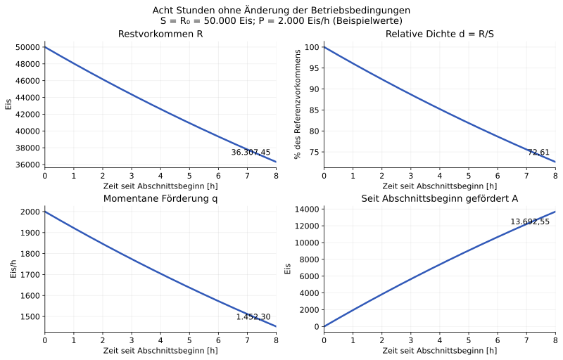
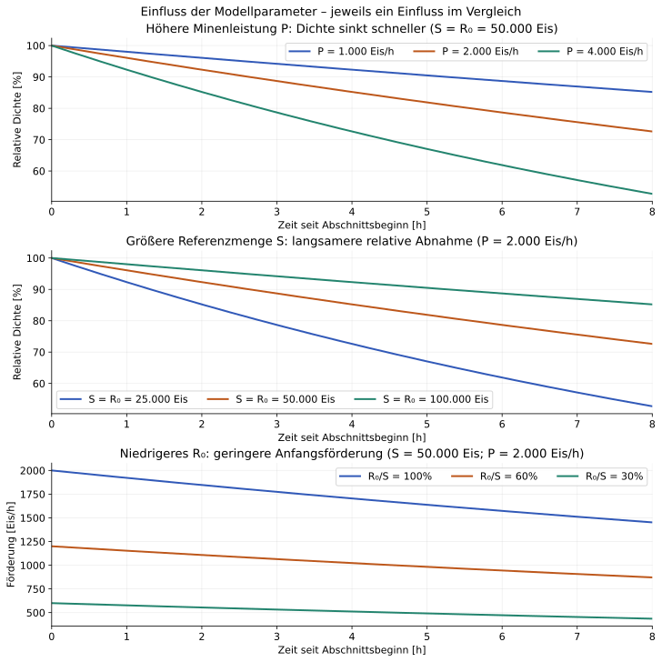
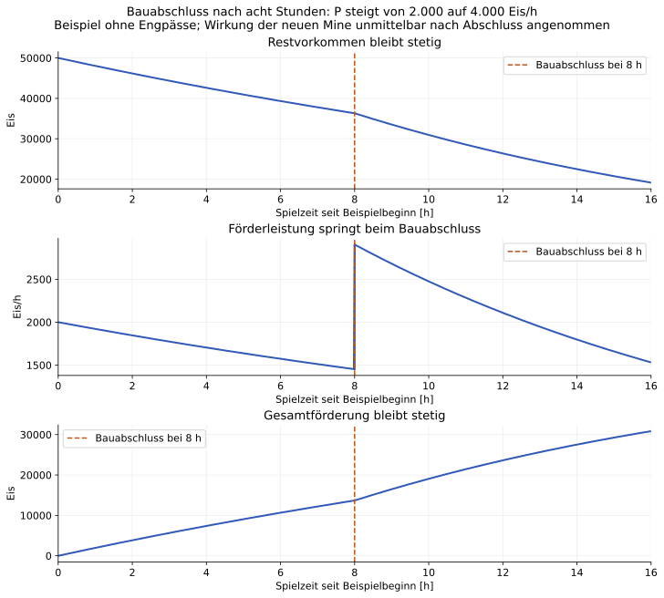

# Kontinuierliche Eisförderung zwischen Ereignissen

**Stand: 2026-11-08.** Der Projektinhaber möchte den kontinuierlichen Verlauf als fachlich-mathematischen Ansatz dokumentiert und weiter berücksichtigt haben. Die folgenden Gleichungen sind eine Herleitung aus dem proportionalen Abbaumodell. Ihre Dokumentation legt weder das endgültige Balancing noch das Ausführungsverfahren der gesamten Simulation fest. Insbesondere ist die Mindestergiebigkeit von Eis noch nicht in diesem Grundmodell enthalten.

## Motivation und Geltungsbereich

Eine große Mine kann im späteren Spiel etwa acht Stunden Bauzeit oder durch Modifikatoren noch mehr benötigen (Projektannahme, keine allgemeine Bauzeitregel). Bleiben die relevanten Bedingungen bis zum Abschluss unverändert und tritt auch innerhalb der Wirtschaft kein früherer relevanter Übergang ein, soll die Förderung dieses Abschnitts direkt berechenbar sein. Acht Stunden entsprechen 28.800 Sekunden: Für die hier beschriebene Abbaukurve reicht eine Auswertung statt 28.800 aufeinanderfolgenden Sekundenschritten.

Dabei bleibt die **Förderleistung nicht konstant**: Sie sinkt während des gesamten Abschnitts mit dem Restvorkommen. Konstant bleiben die Parameter, welche diese Entwicklung bestimmen. Ein bekannter Bauabschluss allein garantiert noch keinen acht Stunden langen störungsfreien Abschnitt; etwa ein Energiemangel kann früher eintreten.

Der Ansatz beschreibt zunächst **eine einzelne Quelle und die daraus geförderte Menge**. Eis im Boden ist nicht Eis im Lager. Verbrauch im Wasserwerk senkt den Lagerbestand, nicht direkt das unterirdische Vorkommen. Lagerzugänge, verfügbare ganze Einheiten, laufende Produktion und Verbraucher sind zusätzlich gemäß dem [fachlichen Simulationsvertrag](../architecture/resource-simulation-contract.md) zu behandeln.

## Ausgangspunkt: Tabelle und heutiger Modellvorschlag

Quelle ist das frühere eigene Redesign [RD-02 „Resourcenabbau“](https://docs.google.com/spreadsheets/d/1Wng7Wi-kAfF1JS_VECUQVXRTWIYlHXlCo7YKTTP_vnA/edit). Die am 2026-11-08 geprüften Zellen A1:G12 enthalten:

- 50.000 Einheiten Startvorkommen in A5;
- 20 Einheiten Grundförderung je Mine und Tick in A8;
- Restvorkommen als Startvorkommen minus bisherigem Abbau;
- relative Dichte als Restvorkommen geteilt durch Startvorkommen;
- Förderung als Grundförderung × Minenzahl × relative Dichte;
- eine zusätzliche Mine alle zehn Ticks im Beispielszenario.

Das ist kein Beleg für die historische IceWars-Formel und keine Festlegung heutiger Gebäudeparameter. Die Tabelle definiert hier keine physikalische Tickdauer. **20 Eis/Tick darf deshalb nicht ohne Annahme in 20 Eis/Sekunde oder 20 Eis/Stunde umgedeutet werden.** Die folgenden Stundenwerte sind eigens gewählte Rechenbeispiele. Der kontinuierliche Verlauf ist ein anderes mathematisches Modell als die bisherige Tick-Folge, keine exakt ergebnisgleiche Zusammenfassung dieser Folge.

## Parameter und abgeleitete Größen

Der Abschnitt beginnt bei Spielzeit $t_0$. Mit $\tau=t-t_0$ bezeichnen wir die seitdem verstrichene Zeit.

| Symbol | Bedeutung | Einheit / Einschränkung |
| --- | --- | --- |
| $S$ | Feste Referenzmenge der Quelle; im Tabellenmodell das ursprüngliche Startvorkommen | Eis; $S>0$ |
| $R_0$ | Restvorkommen zu Beginn **dieses** Abschnitts | Eis; $0\le R_0\le S$ |
| $P$ | Zusammengefasste Förderleistung bei relativer Dichte 1, einschließlich der im Abschnitt konstanten Betriebsmodifikatoren | Eis/h; $P\ge0$ |
| $\tau$ | Dauer seit Abschnittsbeginn | h; $\tau\ge0$ |
| $k=P/S$ | Relative Abnahmekonstante | 1/h |
| $R(\tau)$ | Restvorkommen nach dieser Dauer | Eis |
| $d(\tau)=R(\tau)/S$ | Relative Dichte beziehungsweise Ergiebigkeitsfaktor | Dimensionslos; 0 bis 1 |
| $q(\tau)=P\,d(\tau)$ | Momentane tatsächliche Förderrate | Eis/h |
| $A(\tau)=R_0-R(\tau)$ | Während dieses Abschnitts geförderte Menge | Eis |

**S bleibt beim nächsten Ereignis unverändert.** Nur R₀ wird auf das dann verbleibende Vorkommen gesetzt. Würde S ebenfalls auf den neuen Rest gesetzt, würde die relative Dichte bei jedem Ereignis wieder auf 1 springen.

P ist nicht die tatsächliche aktuelle Förderung: Bei P = 2.000 Eis/h und relativer Dichte 0,6 beträgt diese nur 1.200 Eis/h. Verschiedene Minentypen auf derselben Quelle können in P addiert werden, sofern sie denselben Dichtefaktor nutzen und ihre übrigen Leistungsparameter konstant sind. Quellen mit anderen Parametern werden zunächst getrennt behandelt.

**Relative und absolute Dichte unterscheiden:** d = 1 bedeutet die volle Referenzergiebigkeit dieses Modells, nicht 100 Prozent absoluten Eisanteil eines Planeten. Soll eine absolute Anfangsdichte von beispielsweise 30 Prozent abgebildet werden, braucht es eine ausdrückliche Zuordnung zu Referenzmenge und Förderleistung. Diese ist noch keine beschlossene Spielregel.

## Herleitung und direkte Berechnung

Der Abbau entspricht der tatsächlichen Förderung. Je weniger Eis verbleibt, desto geringer wird diese Förderung:

$$
\frac{dR}{d\tau}=-q(\tau)=-P\frac{R(\tau)}{S}=-kR(\tau).
$$

Die Lösung mit Anfangswert R₀ ist eine exponentielle Abnahme:

$$
\boxed{R(\tau)=R_0\,e^{-k\tau}=R_0\,e^{-\frac{P}{S}\tau}}.
$$

Daraus folgen direkt:

$$
d(\tau)=\frac{R_0}{S}e^{-k\tau},\qquad
q(\tau)=P\frac{R_0}{S}e^{-k\tau},\qquad
\boxed{A(\tau)=R_0\left(1-e^{-k\tau}\right)}.
$$

Der Exponent ist dimensionslos: (Eis/h) / Eis × h. Bei Zeitangaben in Sekunden muss P in Eis/s umgerechnet werden oder die Dauer durch 3.600 geteilt werden.

A ist die gesamte Förderung über den Zeitraum, also die Fläche unter der Kurve q. Weder Anfangsrate × Dauer noch Endrate × Dauer bildet diese Fläche korrekt ab. Die Bilanz lautet immer R(τ) + A(τ) = R₀.

Für P = 0 bleibt das Vorkommen unverändert und die Förderung ist null. Für R₀ = 0 gilt dasselbe. Bei τ = 0 gibt es keinen neuen Abbau.

## Beispiel 1: Acht Stunden bis zum nächsten Bauabschluss

**Nur Rechenwerte, kein Balancing:** S = 50.000 Eis, R₀ = 50.000 Eis, P = 2.000 Eis/h. Alle Betriebsbedingungen bleiben für acht Stunden erfüllt; keine Lagergrenze oder sonstige Wirkung verändert den Betrieb. Damit ist k = 0,04/h.

$$
R(8)=50.000\,e^{-0{,}04\cdot8}\approx36.307{,}45\text{ Eis}.
$$

In den acht Stunden werden **13.692,55 Eis** gefördert. Die Förderrate sinkt dabei von 2.000 auf **1.452,30 Eis/h**.

| Dauer | Restvorkommen [Eis] | Relative Dichte | Momentane Förderung [Eis/h] | Im Abschnitt gefördert [Eis] |
| ---: | ---: | ---: | ---: | ---: |
| 0 h | 50.000,00 | 100,00 % | 2.000,00 | 0,00 |
| 1 h | 48.039,47 | 96,08 % | 1.921,58 | 1.960,53 |
| 4 h | 42.607,19 | 85,21 % | 1.704,29 | 7.392,81 |
| 8 h | 36.307,45 | 72,61 % | 1.452,30 | 13.692,55 |
| 12 h, falls weiterhin unverändert | 30.939,17 | 61,88 % | 1.237,57 | 19.060,83 |



Restvorkommen und Förderrate sinken. Die insgesamt geförderte Menge steigt weiter, aber immer langsamer. Mit fälschlich konstanter Anfangsrate kämen 16.000 Eis heraus: **2.307,45 Eis zu viel**, rund 16,85 Prozent über dem kontinuierlichen Ergebnis. Dieser Fehler ist von der viel kleineren Abweichung einer fein aufgelösten Tick-Näherung zu unterscheiden.

## Beispiel 2: Welche Parameter verändern den Verlauf?



- **P erhöhen:** Mehr Förderkapazität liefert anfangs mehr Eis, senkt aber auch die Dichte schneller. Bei S = R₀ = 50.000 Eis verbleiben nach acht Stunden für P = 1.000 / 2.000 / 4.000 Eis/h etwa 85,21 / 72,61 / 52,73 Prozent relative Dichte.
- **S erhöhen:** Bei gleichem P und gleicher anfänglicher relativer Dichte nimmt die Ergiebigkeit langsamer ab. Im mittleren Chart wird deshalb R₀ gemeinsam mit S verändert. Eine größere Referenzmenge ist ein anderes Vorkommen, kein Zurücksetzen nach einem Ereignis.
- **R₀ verringern, S festhalten:** Ein bereits ausgebeutetes Vorkommen beginnt den Abschnitt mit geringerer Förderung. Bei S = 50.000 und P = 2.000 Eis/h beginnen die Kurven für R₀/S = 1 / 0,6 / 0,3 bei 2.000 / 1.200 / 600 Eis/h. Die relative Abnahmegeschwindigkeit k bleibt gleich.

## Beispiel 3: Nach acht Stunden wird die neue Mine fertig

Für die Illustration verdoppelt der Abschluss P von 2.000 auf 4.000 Eis/h. **Beispielannahme:** Die zusätzliche Leistung wirkt unmittelbar nach dem Abschluss. Dies legt noch keine allgemeine Phasenregel für Fertigstellungen fest.

1. Abschnitt [0 h, 8 h]: Berechnung mit S = 50.000, R₀ = 50.000, P = 2.000.
2. Abschluss bei 8 h: Restvorkommen 36.307,45 Eis übernehmen, P auf 4.000 setzen; S bleibt 50.000.
3. Abschnitt [8 h, 16 h]: Dieselbe Formel mit dem neuen R₀ und P auswerten.

Unmittelbar vor dem Abschluss beträgt die Förderung 1.452,30 Eis/h, unmittelbar danach 2.904,60 Eis/h. Das Vorkommen und die bereits geförderte Menge springen dabei nicht. Nach insgesamt 16 Stunden verbleiben **19.144,64 Eis**; insgesamt wurden **30.855,36 Eis** gefördert. Davon entfallen 17.162,81 Eis auf den zweiten Abschnitt.



Die Kurven werden nur für die Darstellung dicht abgetastet. Für die beiden Endzustände reichen zwei direkte Abschnittsberechnungen; die Chart-Stützpunkte sind keine erforderlichen Simulationsticks.

## Direkte und gestückelte Fortschreibung

Ohne Parameteränderung muss das Ergebnis unabhängig von zusätzlichen Zwischenabfragen sein:

$$
R_0e^{-k(a+b)}=\left(R_0e^{-ka}\right)e^{-kb}.
$$

Acht Stunden am Stück, drei plus fünf Stunden oder 28.800 Abschnitte zu je einer Sekunde beschreiben denselben mathematischen Verlauf. Die geförderten Teilmengen summieren sich zum Gesamtabbau. Damit passt das Modell zur [Unabhängigkeit von Zwischenzeitpunkten](../architecture/resource-simulation-contract.md#etappe-1). Die technische Zahlendarstellung braucht dennoch definierte Toleranzen; mathematische Gleichheit ist nicht automatisch bitweise Gleichheit unterschiedlicher Rechenfolgen.

Die Tabelle verwendet stattdessen für unverändertes P pro Tick:

$$
R_n=R_0\left(1-\frac{P_{\mathrm{Tick}}}{S}\right)^n.
$$

Das ist ebenfalls direkt auswertbar, bleibt aber ein diskretes Modell. Für eine Näherung des kontinuierlichen Modells mit Schrittdauer h gilt P_Tick = P × h. Mit kleinerem h nähert sich diese Folge der Exponentialkurve. Eine Umstellung benötigt deshalb ausdrücklich gewählte Modellsemantik statt einer stillen Änderung der Ergebnisse.

## Abschnittsgrenzen, Schwellen und offene Spielregeln

Die Formel gilt, solange das proportionale Abbaugesetz und seine Parameter gelten. Eine neue Mine, Forschung, ein Bonusende, Stilllegung oder ein wirksamer Versorgungsmangel kann einen neuen Abschnitt erfordern. Eine ohnehin bekannte Zeit bis zum Bauabschluss darf **nicht** über einen früheren wirtschaftlichen Übergang hinweg ausgewertet werden, der die beteiligten Bedingungen verändert.

Für eine positive Restvorkommensschwelle R* kann ihr Zeitpunkt ebenfalls direkt bestimmt werden (P > 0 und 0 < R* < R₀):

$$
\tau_* = \frac{S}{P}\ln\left(\frac{R_0}{R_*}\right).
$$

Das erlaubt etwa, eine später definierte Ergiebigkeitsschwelle rechtzeitig als Abschnittsgrenze zu berücksichtigen. **Beispiel, keine Spielregel:** Bei S = R₀ = 50.000 und P = 2.000 Eis/h wird R* = 25.000 nach etwa 17,33 h erreicht. Eine echte Förderschwelle von 50 Prozent wäre nur bei entsprechender Definition der relativen Dichte dieselbe Schwelle.

| Grenze | Was die Grundformel leistet | Was zusätzlich festzulegen ist |
| --- | --- | --- |
| Mindestergiebigkeit von Eis | Verlauf oberhalb einer später definierten Grenze und deren Erreichungszeit | Positive Mindestförderung ist Designrichtung. Wie danach weiter gefördert wird und woher das Eis stammt, ist offen. Ein endliches Vorkommen plus unbegrenzte dauerhafte Entnahme wäre keine geschlossene Mengenbilanz. |
| Vollständige Erschöpfung | R nähert sich für P > 0 null an | Null wird mathematisch nie in endlicher Zeit erreicht. Kein Erschöpfungsereignis oder Abschalten allein aus dieser Formel ableiten. Numerischer Unterlauf ist keine Spielregel. |
| Volles Lager / Verfall | Geförderte Gesamtmenge | Das bestehende Verfallsprinzip für nicht lagerbare Überproduktion ist zu berücksichtigen. Ob und wie Lagerzustand den Minenbetrieb beeinflusst, muss explizit sein. Förderung ist nicht automatisch Lagerzuwachs. |
| Energie, Personal und weitere Inputs | Konstante Betriebsmodifikatoren können in P eingehen | Bei veränderlicher Versorgung gilt die einfache Exponentialform mit konstantem P nicht unmittelbar. Engpasszeitpunkt und Rückwirkungen brauchen das gemeinsame Wirtschaftsmodell. |
| Ganze verfügbare Einheiten | Kontinuierlicher Abbau und Mengenanteile | Verfügbarkeitszeitpunkte und erhaltene Bruchteile gemäß Simulationsvertrag bestimmen; nicht erst am Abschnittsende alle Förderung verfügbar machen. |
| Andere Mechaniken | Direkter Abbau innerhalb eines gültigen Abschnitts | Relevante Wirkungen mit wirksamer Spielzeit koordinieren. Nicht alle Zwischenereignisse müssen automatisch globale Stopps oder Audit-Ereignisse werden. |

Auch bei unverändertem Minenparameter P können nachgelagerte Betriebe Zwischenübergänge haben. Die Möglichkeit, den Abbau in einem Ausdruck zu berechnen, bedeutet deshalb nicht, die gesamte planetare Wirtschaft ohne weitere Prüfung bis zum nächsten äußeren Ereignis fortschreiben zu können.

## Numerik, Überprüfung und Reproduktion

Für kleine kτ ist die Differenz 1 − exp(−kτ) numerisch ungünstig. Eine spätere Implementierung kann die Förderung stabil als `A = -R0 * expm1(-k * duration)` auswerten. Intern bleiben Mengenanteile erhalten; nur die Anzeige rundet. Zahlendarstellung, Zeitquantisierung und Regeln zur Reproduzierbarkeit sind weiter Architekturfragen.

Die Charts und Beispielwerte lassen sich mit [plot_ice_extraction.py](tools/plot_ice_extraction.py) reproduzieren:

```sh
python -m pip install matplotlib
python doc/game-design/tools/plot_ice_extraction.py
```

Das Hilfsskript gehört zur Dokumentation und fügt dem Spiel keine Python-Abhängigkeit hinzu. Es erzeugt SVGs für diese Seite und PNGs zur lokalen Sichtprüfung. Die SVGs werden versioniert; die PNGs sind reproduzierbare lokale Vorschauen.

Bei Erstellung wurden Mengenbilanz, Nullförderung, leeres Vorkommen sowie direkte und gestückelte Fortschreibung (3 h + 5 h und 28.800 Einsekundenabschnitte) numerisch geprüft. Dies prüft die Modellrechnungen, **nicht** die bisherige Java-Simulationsimplementierung oder die vollständige Wirtschaftskette.

## Konsequenz für die weitere Modellierung

Der kontinuierliche Ansatz ist dokumentiert und soll bei der Ausarbeitung der Ressourcensimulation berücksichtigt werden. Die Beispiele zeigen eine Möglichkeit, längere Abschnitte ohne sekündliche Abbauberechnung auszuwerten. Das ist kein gemessener Leistungsnachweis für die gesamte Engine und keine Entscheidung für Lazy Evaluation, einen Scheduler oder ein Framework.

Nächste fachliche Klärung: Wie wird das proportionale Modell mit der positiven Mindestergiebigkeit verbunden, ohne Vorkommen, Ergiebigkeit und dauerhaft verfügbare Quellen zu vermischen? Danach ist das Zusammenspiel mit Lager, Energieversorgung und der Einheitenverfügbarkeit an konkreten Szenarien zu prüfen.
