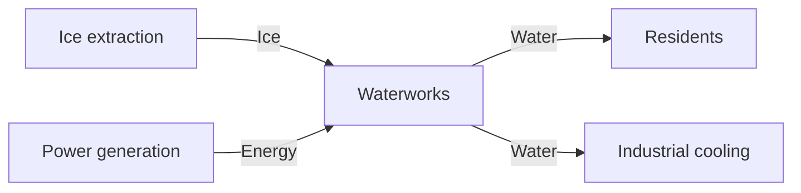

# Planetary Economy

**Status.** Design exploration with some explicitly confirmed rules and directions. A complete rules specification has yet to be accepted.

The [project stages overview](project-stages.md) gives the planned development scope and discussion status. On this page, each initial version refers to the mechanic being described.

## Target Experience (Project Goal)

The economy should go beyond constant income rates. Buildings produce and consume resources, shortages affect other sectors, and planetary deposits can be depleted. Players should be able to trace causes and effects.

## Distinctions Observed in the Current Code

| Level | In the prototype | Interpretation |
| --- | --- | --- |
| Player-wide | **Credits** in `UserAccount`; `ResourceSetMsg` contains `credits` | Available player-wide per project context. Other currency operations remain open. |
| Planetary stock | `PlanetResourceSetMsg`: amounts keyed by `ResourceType` | Local stock covers resources such as iron, energy, population, ice, and water. The resource list is provisional. |
| Planetary deposits | `MiningResourcesMsg`: **iron, deepIron, chemicals, ice, deepIce** | Deposit structure. Depletion logic is a TODO. |

**Stock** and **deposit** describe different concepts. Whether energy and population should behave like storable consumables also remains open.

Source code: [ResourceSetMsg](../../lib/src/main/java/de/bwoester/coldfrontier/accounting/ResourceSetMsg.java), [PlanetResourceSetMsg](../../lib/src/main/java/de/bwoester/coldfrontier/accounting/PlanetResourceSetMsg.java), [MiningResourcesMsg](../../lib/src/main/java/de/bwoester/coldfrontier/planet/MiningResourcesMsg.java), [UserAccount](../../lib/src/main/java/de/bwoester/coldfrontier/accounting/UserAccount.java).

## Production and Dependencies

**Confirmed water recipe.** Producing 1 unit of water consumes 1 unit of ice and 2 units of energy. Throughput and partial operation remain open.

**Current code.** `ProductionService` sums signed hourly rates per resource from all buildings on a planet. Fractional amounts carry forward across ticks. The result includes any credits generated on the planet, which are booked to the owning player account. It does not yet account for shortages, input availability, or modifiers. `IRON_MINE` is an example configured with positive iron production and negative energy production. These values are provisional.

**To investigate.** Input and output recipes, simultaneous competing consumers, priorities, partial operation, storage eligibility, time resolution, rounding, saturation, and cascading shortages.

## Declining Yield and Time as a Resource

**Status.** The project owner confirmed this design direction on 2026-11-01. Specific rules, curves, and thresholds remain under discussion. Historical IceWars values are documented separately in [[icewars-references#Player Recollection – Ice Extraction and Competing Construction Priorities|the IceWars account of ice extraction and competing construction priorities]].

Declining deposit yields should increase the effort required to maintain supply. Additional extraction facilities compete with research, military, and other economic buildings for limited construction capacity. Technologies can temporarily ease that pressure. Alternative sources should restore room for long-term development.

**Time as a resource** refers to the limited ability to put up buildings over a given period. Even with enough materials, a player cannot build hundreds of additional mines in a short time. Compensating for declining yield delays other projects. The number of construction queues and whether to model time as a storable resource remain open.

- **Design intent.** Encourage adaptation and forward planning for supply, and use humor to communicate the consequences of overexploitation.
- **Short-term options.** Alternative technologies or extraction methods should offer initial relief. Their exact effects remain open.
- **Strategic alternatives.** Colonization or large-scale mining. The latter is a separate destructive mechanic whose rules and interactions still need design.
- **Implication.** A positive minimum yield can still provide meaningful pressure to adapt. Building more mines may be technically possible while their build time and the development they displace make a new source strategically necessary.
- **Open question.** How early do players notice the pressure, and which responses remain within reach? Avoid a downward spiral that players notice too late to recover from.

### Continuous Extraction Between Events

The [continuous ice extraction approach](continuous-ice-extraction.md) discussed on 2026-11-08 documents the proportional depletion curve, its parameters, and direct calculation over longer intervals. Examples and charts show eight hours without intervention and a subsequent mine expansion. Minimum yield, balancing, and integration with the full economy remain open, as does the technical time model. The [long-term and extreme scenarios](extraction-balancing-scenarios.md) compare large and small deposits, expansion rates, and idealized compensation requirements. The preliminary balancing target from the 2026-11-08 discussion is for ice depletion to become noticeable around one-third of the way through a round and strategically problematic around two-thirds. Iron depletion could be made negligible. Round duration, expansion paths, and measurable impact criteria remain open.

### Minimum Yield and Survival During Absence

**Confirmed protection goal.** Resource scarcity should not wipe out an account during a prolonged absence such as a vacation solely because its ice supply dries up. New players in particular should retain a basis for continued supply.

**Dependencies.** Water is made from ice, and the population consumes water to survive. The population rules confirmed on 2026-11-02 and the survival protection to verify are documented in [[economy#Population, Housing, and Water Supply|Population, Housing, and Water Supply]]. Growth and decline rates and the specific protection mechanism remain open.

Ice should therefore retain a positive minimum yield so extraction and, in principle, water production can continue. There is no automatic refill of ice or water stocks. The goal is to keep at least some of the population alive. Preserving the entire existing population or economy is outside that guarantee. A corresponding floor for all other resources has yet to be decided.

**Still to demonstrate.** Positive ice density alone cannot guarantee a viable supply. Energy, labor, processing facilities, and allocation of scarce resources can still interrupt the chain. Determine how minimum supply can continue without manual intervention and whether a viable remaining population can stabilize. Specific protection mechanisms will follow from that work.

**Open balancing questions.** Initial density, minimum density, extraction capacity, depletion curve, time until pressure becomes noticeable, and supply to a remaining population. Cold Frontier has yet to adopt the historical values of 5% and 15%.

## Population, Housing, and Water Supply

**Source and status.** The rules and protection goal were explicitly confirmed in the project discussion on 2026-11-02. No formulas were carried over from IceWars sources.

| Situation | Confirmed behavior |
| --- | --- |
| Free housing and sufficient water | The population grows. The growth rate and exact conditions remain open. |
| Housing is lost | The population immediately drops to remaining housing capacity if it exceeds it. Losing unused capacity leaves the population intact. |
| Water production falls below consumption while stocks still cover demand | The stock covers demand. The production deficit alone causes no population loss. |
| The stock can no longer meet water demand | The population shrinks over time until supply is sufficient for the remaining population. The decline rate and partial supply behavior remain open. |

**Confirmed protection goal.** A previously inhabited world should retain a viable population without player intervention despite a water shortage and the resulting feedback between production and labor. Protection applies per planet. The survival of a separate colony does not satisfy it.

**Scope.** The protection goal concerns supply and leaves the confirmed housing cap in force. Whether it applies when all housing is lost, facilities are destroyed, or the planet suffers military annihilation is a separate open rule. The primary test case assumes positive housing capacity and existing supply facilities.

### Feedback Case: Water Production Needs Labor

**Risk to evaluate in simulation.** A water shortage reduces population. A smaller population can mean fewer workers and lower ice or water production. Declining supply could then cause additional losses. Prioritization alone cannot guarantee stability when total supply capacity shrinks with the population.

**Two proposed approaches:**

1. **Autonomous ice and water production.** These facilities require no population as labor. This removes the labor dependency. Other dependencies, such as energy or inputs, still need consideration.
2. **Guaranteed basic supply.** A supply mechanism to be defined sustains at least a viable remaining population. Scope, triggers, dependencies, costs, and interaction with regular production are open.

Other options or combinations remain possible. Include labor demand for energy supply and other inputs in the evaluation. Positive minimum ice density alone does not establish that the protection goal is met.

**Domain test criteria to define.** What remaining population is viable? Can it sustain its basic needs indefinitely and grow again when conditions improve? A mathematically positive population that approaches zero or becomes unable to act because of rounding is insufficient. A numerical population floor or a free production bonus has yet to be decided.

### Autonomous Starting Habitat (Proposal)

**Proposed design (2026-11-24).** At founding, the colony ship becomes an indestructible colony headquarters. It provides shelter and housing, and it produces basic drinking water without external deliveries, stocked inputs, power, or staffing. The basic service would be permanently available so the player cannot remove the last independent source. The scope of shelter and protection for stored materials remains open.

**Minimum service.** With other water production stopped and water stocks empty, the headquarters must deliver water in time to sustain a viable remaining population. Competing consumers cannot take the residents' share. Set the protected population and effective water output together with [#41](https://github.com/bwoester/cold-frontier/issues/41). An average rate that meets demand is necessary. The timed scenario also has to account for the first delivery, whole units, and how population declines before the supply arrives.

**Balancing candidates.** Housing for 200 and slow growth starting from a surviving population of at least two, given spare housing and sufficient water. These figures are provisional. Housing capacity and the population that the water output can sustain are separate. If two residents can survive on the basic output, growth beyond two also requires water for the additional population.

**Recovery scope.** Basic water production can restore drinking-water service directly while the regular waterworks is offline. The player is responsible for providing any additional infrastructure and inputs that the regular waterworks needs. The headquarters does not need to provide startup energy to meet its basic service requirement. The first construction materials arrive as a one-time shipment on the colony ship. Rebuilding may require a transport with missing materials.

### Priority During Water Shortages

**Confirmed rule (2026-11-03).** Available water first meets the drinking water needs of the entire current population. Other consumers can use the remainder. If the water is insufficient for the population, apply the stock and population decline rules.

A facility whose demand cannot be met experiences a shortage. Define its consequences per consumer and input. Reduced output and possible damage to buildings that rely on cooling are proposals. Thresholds, duration, recovery, and sharing the remainder among facilities of equal priority remain open.

**Test case for S11.** With 300 residents, an empty stock, and enough habitat production for 200, the population receives all available water. Another consumer receives none. Its specific response remains open.

### Colony Survival and Critical Supply

**Game rule.** Each colony automatically prioritizes sustaining its own population during a shortage. Drinking water is the currently defined ongoing survival need. Available drinking water goes to the entire current population first. Production reallocation is conditional on the stock coverage described below. An ongoing deficit can still exhaust stocks and cause population decline. [S11](#s11--survival-despite-water-and-labor-feedback) defines the goal of sustaining a viable remaining population.

**Confirmed requirement (2026-11-24).** The player must retain the colony's last independent recovery path for essential supply. An independent path can use the colony's own stocks and operable infrastructure without a new shipment, construction order, or manual restart. The [headquarters proposal](#autonomous-starting-habitat-proposal) would meet the minimum drinking-water requirement directly. The guarantee covers the survival needs of a viable remaining population. Beyond that minimum, the player is responsible for designing and sizing the colony's production chains. Restart and full utilization of ordinary facilities depend on their actual supply, staffing, and operating conditions.

**Demand.** Drinking water is an ongoing consumption process with water as its input and no material output. Staffing does not exempt a resident from this demand. The amount per resident per game hour is open ([#41](https://github.com/bwoester/cold-frontier/issues/41)). The [reviewed IceWars sources](icewars-references.md#drinking-water-and-population) give no verified historical rate.

**Proposed allocation order ([#30](https://github.com/bwoester/cold-frontier/issues/30)).**

1. **Drinking water.** While existing stock can cover residents' drinking-water needs, leave the normal production allocation in place for this purpose. When stocks run too low to cover those needs, prioritize feasible water production, including the upstream inputs and workers it needs. Where feasible, target sustained production that covers resident demand before allocating any water to other consumers, including consumers within the supply chain. Check that the chain can actually operate with those allocations. For example, a generator can count toward sustained supply only if its own cooling needs can also be met. When full coverage is infeasible, reduce the shortfall as far as feasible and apply the population rules above.
2. **Fixed upkeep.** Use the remaining eligible supply to cover whole upkeep demands of existing infrastructure. Apply any modeled building-specific consequences to the affected facilities.
3. **Other production.** Apply the mining and recipe rules to the remaining eligible stock and operational infrastructure. Further optimization and possible player control are open.

The stock coverage horizon, the conditions for restoring curtailed production, the choice among feasible allocations, and input reservations for blocked processes remain open.

**Example for #30.** Residents need 2 water per hour. The waterworks can make 2 per hour using 2 ice and 4 energy. The colony can supply the ice and generates 4 energy per hour after other essential loads. The steelworks competes for 2 of those 4 energy per hour and the colony has no spare energy in stock. While the water stock covers resident demand, the colony uses it and does not curtail the steelworks for drinking water. When the stock can no longer cover demand, curtailing the steelworks can free enough energy for full water production. If the colony can extract only 1 ice per hour and has no ice in stock, the waterworks can sustain at most 1 water per hour even with all 4 energy. These rates are illustrative and assume the required inputs are available when due.

**Power example.** Self-sufficient power generation is a design direction. Solar panels or solar power plants are candidates that can produce energy once built without ongoing supplies such as cooling water. The player can choose water-cooled generation instead. If the colony runs out of power and its only water is needed for drinking, its water-cooled plant and regular waterworks can remain idle while the protected supply keeps residents alive. An installed, operable independent power source can help restart the regular chain if it supplies enough energy and the waterworks also has ice and staffing. See #30 for the recovery scenarios.

**Industrial example.** Test values: A steelworks needs 10 iron per hour at full capacity. Its mines supply 6 per hour and no stock or delivery makes up the gap. The colony can operate only within that input budget over time. The player can add extraction capacity, arrange imports, or accept idle time. The exact timing and output depend on whole-unit starts and the effective recipes.

**Confirmed initial rule for fixed upkeep.** When fixed upkeep is due, a building either pays the full amount in every required resource or pays nothing. Deduct all required resources together only if the building can be fully supplied. An unpaid demand leaves all of its resources available for other eligible uses. Fixed upkeep remains due even when an optional production recipe is stopped. [#47](https://github.com/bwoester/cold-frontier/issues/47) tracks how to choose among competing demands. [#49](https://github.com/bwoester/cold-frontier/issues/49) covers building-specific consequences, including the agreed controlled descent of an orbital shipyard that cannot pay its upkeep. Actual operating requirements and recipe ingredients still determine whether production is feasible. The headquarters proposal supplies its protected minimum independently of ordinary upkeep.

**Example.** Two buildings each need 2 water and 3 water remain after drinking-water allocation. Pay one demand in full and leave 1 water available. Total demand is 4, payment is 2, and unmet upkeep is 2. If 1 water and 2 energy are due at the same game time and only 1 water and 1 energy remain, deduct neither resource for that demand.

**Confirmed payment timing.** The first payment for upkeep applicable to a new building is due at its effective completion time. Each required resource is paid one whole unit in advance. That unit covers the time it takes to consume it at the applicable rate. Each resource renews when its own paid coverage expires. Apply all-or-nothing payment to the units due for the same building at the same effective game time. An empty stock does not interrupt coverage already paid for. If a payment fails, the shortage takes effect at that time. [#36](https://github.com/bwoester/cold-frontier/issues/36) still tracks whether production completing at the same time can fund the payment.

**Example of different rates.** A building completes at 12:00 and needs 2 fuel and 1 energy per game hour. Pay 1 of each at 12:00 and a second fuel at 12:30. This covers the first hour. At 13:00, both renewals are due together. If either is unavailable, neither is withdrawn.

**Confirmed shutdown and restart.** A failed payment creates no arrears. When an upkeep-dependent operation shuts down, its upkeep stops accruing at the effective shutdown time. No further payment for that operation is due while it is shut down. When it resumes under its building-specific rules, new payments cover operation from that point forward.

The [fixed upkeep Gherkin scenarios](scenarios/fixed-upkeep.feature) specify payment timing, shutdown, and recovery.

**Confirmed research upkeep effect.** A research facility whose fixed upkeep is unpaid contributes zero research points per hour to its owner's research capacity. Ongoing research uses the remaining capacity from the effective game time of the change. If total capacity falls to zero, ongoing research pauses and retains accumulated progress. A facility can contribute again when its upkeep is fully paid and its other operating requirements are met. See [account-wide research](#account-wide-research) for start and slot rules and [S7](#s7--impaired-construction-or-research-progress) for a capacity example.

### Resource Allocation Audit

The audit history explains the colony's allocation decisions and their consequences at the effective game time:

- **Drinking-water optimization.** When it is triggered, record what the normal allocation would have produced or supplied, the projected shortfall that triggered the change, the strategy chosen, and its effect on supply and affected operations. In the steelworks example, show the competing energy demand, the energy redirected to the waterworks, and the change in drinking-water output.
- **Fixed upkeep.** Record the demand, the amount paid, and any shortfall. Where building-level effects are modeled, identify the infrastructure that cannot be supplied and the shutdown or other transition it enters. For an orbital shipyard, this includes the controlled descent and pause in ship construction. Colony-level totals can summarize demand, payment, and unmet upkeep by resource.
- **Mining and recipes.** Show what mining and recipes do with the remaining eligible stock and operational infrastructure, including relevant output, recipe starts or blocks, and their effective order when they share a game time.

### Planned Verification

S9–S11 below are domain test specifications. Once production, consumption, labor, and population rules are defined, implement S11 in particular as an automated simulation regression test. **Documented, awaiting simulation.** The necessary formulas and protection mechanism remain open. An example implementation now would have to invent undecided game rules.

## Population and Labor

**Clarified by the project owner on 2026-11-02:**

- Every citizen is available to work in principle. The initial design has no separate labor participation rate or population groups.
- Buildings create ongoing labor demand. Economic work does not consume citizens as a material.
- If population exceeds ongoing staffing needs, the surplus is **free population**. It enables orders with a population cost.
- If population falls below staffing needs, the economy is understaffed. How the productivity of individual buildings falls remains open.
- Whether individual construction and research orders need ongoing staff or only their operating buildings do remains open.

**Terms.** For population P and total ongoing building staffing demand D, the surplus is max(0, P − D) and the shortfall max(0, D − P). These figures describe demand and leave staffing order and productivity formulas open. With demand of 1,000 and 800 citizens, the shortfall is 200 workers.

### Construction Costs, Ongoing Consumption, and Staffing

**Confirmed distinction, 2026-11-02.** Buildings and vehicles can have construction costs and ongoing operating costs. Define which costs apply to each type.

| Cost or requirement | Unit and meaning | Effect |
| --- | --- | --- |
| Construction cost | One-time resource amount, optionally including population | Deducted from the respective stock. Cancellation refunds follow the separately defined refund rule. |
| Ongoing resource consumption | Amount per unit of time, likely shown per hour according to the project owner | The stock falls by the amount actually consumed during operation. Exact rates, partial operation, and behavior during shortages remain open. |
| Ongoing staffing demand | Number of citizens assigned at the same time | Citizens remain part of the population and are unavailable for other work or as free population while assigned. There is no repeated hourly deduction. |

**Population as a construction cost.** A one-time population cost removes citizens from the population stock being charged. Ongoing staffing ties up citizens without consuming them. Both may apply to the same type. A fleet crew system remains open. The narrative explanation for spending population, such as assignment to a crew, does not establish that the citizens died.

**Example to clarify the terms.** With 1,000 residents and a staffing need of 800, 200 are free. A one-time population cost of 100 reduces the population to 900 and leaves 100 free if demand stays the same. An additional ongoing staffing need of 100 leaves 1,000 residents and raises demand to 900, also leaving 100 free. Those assigned in the second case still count toward water and housing demand. Any separate supply for the people removed from the planet's stock in the first case remains undefined.

**Still open.** Releasing staff when facilities close, casualties from destruction, refunding one-time population costs on cancellation, and assigning population stocks to vehicles. Ongoing staffing does not automatically reserve people for queued construction orders.

**Deferred ideas:**

- Model fleet personnel separately or solely through population construction costs.
- Reassign staff between the economy and fleet, and temporarily deactivate ships.
- These options remain open. Crew management is outside the scope of the first economy model.

### Allocation and Productivity During Understaffing

**Status as of 2026-11-02.** Prioritizing critical infrastructure is a confirmed direction. Which parts of the supply chain qualify and how much essential supply to protect remain open. Preventing full extinction (S11) remains a separate requirement.

Decide the following three questions separately.

| Topic | Question | Status |
| --- | --- | --- |
| Labor allocation | How many citizens does each facility receive when labor is scarce? | Automatic allocation prioritizes [critical infrastructure](#colony-survival-and-critical-supply). The algorithm is open. Allocation proportional to demand is a simple starting candidate. |
| Productivity | How much does a facility produce given its staffing? | Linear scaling is a pragmatic starting candidate. A curve with modest effects for mild shortages and severe effects for larger shortages is a later option. |
| Timing | When does understaffing take effect, how long does it last, and how does recovery work? | A grace period or delayed effect is an idea. Duration, fatigue, and backlog rules remain open. |

With prioritization, use the **staffing ratio per facility**. A fully staffed facility receives no global shortage penalty solely because other sectors are understaffed. The exact allocation of productivity remains open.

**Possible stages, subject to future decisions:**

1. **Simple start.** Allocate automatically, protect critical supply, and cover other staffing needs proportionally. Initially scale output linearly with actual staffing. Linear scaling remains a proposed formula.
2. **Selectable priority profiles.** For example, extraction, shipbuilding, or trade. Players can set priorities without managing each facility. Define the protected supply so a profile cannot accidentally bypass survival protection.
3. **Individual control.** Players decide where citizens work. Deferred to a possible later stage.

Assess productivity curves and delayed effects independently of these control levels. A general strategy, rule, or plugin framework is currently outside the requirements.

**Specialization idea.** Genetics could support economic specialization and reward collaboration. See [[icewars-references#Player Recollection – Specialization Through Genetics|the IceWars account of genetic specializations]]. A switchable allocation profile and a permanent specialization bonus have different effects. Their integration, costs, and whether specializations can change remain open.

**Edge cases and future tests:**

- **Small shortfalls.** A nearly flat initial curve could make sustained, deliberate understaffing attractive. Assess the size of this possible strategic effect.
- **Resetting the grace period.** Check whether briefly restoring or reallocating staff repeatedly can indefinitely avoid penalties. Assess whether penalties track the length or severity of the shortage and how fast recovery occurs. No particular memory or fatigue formula is assumed.
- **Reassignment.** Define what happens to existing strain or backlogs when a profile changes. A citizen cannot be assigned to multiple jobs at the same time.
- **Advancing in time.** Any grace period must work independently of logins and consistently for both short increments and long advances.
- **Interactions.** Test staffing shortages, missing inputs, and basic supply together with S11. Adding staff must not enable indefinite operation without consuming required materials.
- **Traceability.** Players should see actual staffing, output, and remaining grace period where applicable. Development and support must be able to reproduce relevant inputs and timing effects.

These cases describe future checks for rules still to be decided.

## Buildings and Construction

**Confirmed initial scope.** Players cannot demolish buildings or select individual buildings for destruction in an attack. Ordinary raids fight defending ships and defensive structures and leave ordinary buildings outside the set of targets. Ordinary buildings can be destroyed only if the attacker explicitly chooses to attack infrastructure instead of raiding for resources and the fleet includes bombers or other ship classes capable of attacking infrastructure. Combat resolution determines which eligible buildings are lost. The exact selection method remains open.

**Deferred idea.** Let players manually mothball individual buildings. The effects on operating benefits and upkeep would need a separate decision if this is revisited.

**Current code.** The enum includes an iron mine, a solar cell, solar, coal, and nuclear power plants, a steelworks, an observatory, energy storage, housing, a bunker, a town center, a defense platform, and a shipyard. A construction queue and construction progress exist. The building list remains provisional.

### Costs, Cancellation, and Progress

**Source and status.** The project owner clarified these points on 2026-11-02. The table identifies confirmed rules and design directions.

| Aspect | Documented behavior | Status and scope |
| --- | --- | --- |
| Construction costs | Deduct costs when the order enters the queue, even if it must wait. | Confirmed rule. The point at which research costs are deducted has not been separately confirmed. |
| Voluntary construction cancellation | The player receives only part of the resources spent, even for an order that is still waiting. | Confirmed rule. A fixed share applies regardless of progress. The share, rounding, and affected resources remain open. |
| Purpose of cancellation losses | Construction slots should not provide lossless protection against raids. | Confirmed design intent. Partial refunds alone might still leave profitable protection strategies. |
| Buildings and research under impaired conditions | Progress should slow, for example when power is scarce. | Confirmed design direction. Define triggers, severity, combined effects, and recovery. The preliminary preference is to avoid a complete stop. Research with zero research capacity pauses under the confirmed upkeep rule. No general loss of existing progress has been established. |
| Orbital shipyards | Destruction also destroys ships being built there. | Confirmed rule. Treat waiting orders as voluntarily canceled. Destruction triggers remain open. |
| Different order types | Conditions and consequences can differ for construction, research, and shipbuilding. Other rules can follow. | Game design flexibility. There is no requirement for a universal job framework or plugin system. |

**Time and costs.** Prepaid construction costs and progress over time are separate domain quantities. Limited construction capacity makes time strategically valuable without requiring a shared account that spends both time and materials. The earlier model of consuming time continuously as a resource is historical design work. Ongoing staffing is defined as an assigned number of people. Consumable operating inputs are expressed as amounts per unit of time. Specific energy, consumption, and progress rules remain open.

**Open edge cases and checks on design intent:**

- **Queue.** Costs are deducted when the order is queued. Starting the work later does not charge it again.
- **Refunds.** The same fixed share applies to active and waiting construction orders, based on the price actually paid including the queue surcharge. The share is independent of progress. Its size, rounding, and storage limits when crediting the refund remain open.
- **Correction window (proposal).** Players might be able to reverse a mistaken order within a few minutes without loss. This must not provide extra protection against raids. Test queuing construction shortly before an attack, reversing the order before or during the attack, and receiving a full refund afterward. Also test repeated queuing and reversal. Duration and exact rules remain open.
- **Resource protection.** Even with losses, investing resources in construction orders can pay off if the expected refund exceeds the stock that would survive an attack. Test whether this happens under the rules.
- **Cancellation, incidents, and destruction.** The partial refund applies to voluntary construction cancellation. Destroyed shipyards lose ships under construction per S8. Refunds after destruction remain open.
- **Progress.** Specific slowdown triggers, a possible zero rate, resumption, and the order of other simultaneous events remain open. The timing boundary is documented under [Construction Completion and Production Progress](#construction-completion-and-production-progress).
- **Free construction minutes.** The [[icewars-references#Player Recollection – Free Construction Minutes|historical acceleration mechanic]] is separate from the rules for Cold Frontier.

### Construction Completion and Production Progress

**Confirmed rules (2026-11-17):**

1. Until the effective completion time, calculate production with the facilities that were already in place. The construction site contributes no production.
2. At the effective time, account for the new building as complete. Completion itself creates no resources and does not change production retroactively during the construction period.
3. After completion, the building can produce according to its operating conditions. A tick or advancement call must not introduce an additional delay.

This sequence defines when the gameplay effects apply. Technical phases, tick duration, and calculation method remain open, as do other actions that take effect at the same time and their priorities.

**Rates and availability.** Building production rates are displayed per hour. Internal time units, calculation frequency, and crediting frequency remain open. A whole unit becomes available as soon as production reaches the amount needed under the effective operating conditions. For extraction, determine that amount per colony and resource as described below. There is no fixed delay, such as a minute before the first unit.

**Production progress and player actions.** Unfinished fractions are domain-relevant production progress. Players cannot spend them as whole units, and subsequent production must retain them. Whether the implementation stores fractions directly or represents progress in another lossless way remains open. For extraction, pool the amounts under the next rule. For processing, pool capacity per colony and recipe as described below.

**Independence from queries and advancement intervals.** Given the same initial state and effective changes, extra intermediate queries or shorter advancement intervals must neither lose production nor delay availability of whole units. This also applies to advancement across construction completion. The new building contributes only for the time after completion.

**Test example with no fixed time unit.** A newly completed building starts with zero production progress. It is supplied throughout, and storage limits and other interventions are outside the example. Two consecutive intervals each yield half a unit of progress.

| Checkpoint | Total produced | Available for player actions | Remaining fractional progress |
| --- | ---: | ---: | ---: |
| At completion | 0 | 0 | 0 |
| After the first interval | 0.5 | 0 | 0.5 |
| After the second interval | 1 | 1 | 0 |

Advancing directly across both intervals must yield the same state and effective time of availability. Evaluating the same game time again creates no further production. The duration of each interval follows from the rate and operating conditions in the test and establishes no general rule.

### Pooled Extraction per Colony and Resource

**Confirmed rule (2026-11-17).** Pool all amounts of the same extracted resource within a colony, including fractions. Whole units of the total are available, and the remaining fraction is retained as shared extraction progress. Individual mines need not complete whole units. Keep resources and colonies separate.

Each building contributes according to its actual operating time and output. A new building adds extraction from completion onward and preserves the fractional progress already earned. The same total extraction under the same conditions yields the same available quantities and remaining progress, regardless of the distribution across buildings. Use effective rates so pooling accounts for actual shortages and operating conditions.

**Player experience.** Availability follows the colony's total extraction. Many slow mines together regularly yield usable units without waiting for individual mines to finish.

The [pooled extraction Gherkin scenarios](scenarios/pooled-extraction.feature) explicitly compare one mine at 6 iron per hour with two mines at 3 iron per hour each. They also test retention of the shared remainder and completing a new mine when fractional progress already exists. All rates and times are test values.

### Pooled Processing per Colony and Recipe

**Confirmed order (2026-11-21).** Apply mining results to the colony's stockpile
before evaluating new recipe starts at the same game time. A recipe can start using
newly available whole mined units immediately, with progress accruing from that time.
The [resource allocation audit](#resource-allocation-audit) must distinguish mining and recipe changes and show their order when both take effect at the same game time. See the [proposed alternative](#common-stock-snapshot-for-resource-updates-proposal).

**Confirmed rule (2026-11-17).** Buildings with the same recipe in a colony contribute capacity to a shared processing operation according to their effective operating conditions. The operation draws a single set of ingredients for each unit. Keep colonies and recipes separate.

Processing a whole output unit starts as soon as all its inputs and effective processing capacity are available. Withdraw all inputs together from the pool exactly once and assign them to the shared unit in progress. One complete set of inputs suffices regardless of how many buildings contribute. If a component is missing, nothing is withdrawn and the unit does not start.

Retain fractional progress already made. A whole output unit becomes available when pooled processing completes it. If inputs and effective capacity are available, the next unit starts at that same game time without additional delay. Additional advances must not withdraw inputs again, lose progress, or credit output twice. A unit already started needs no further set of inputs, so a shortage for the next unit cannot prevent it from finishing.

**Effect of new construction on processing in progress.** Until effective completion, only existing capacity counts. From completion onward, a new building with the same recipe contributes to the remaining work of a unit already started. Retain existing progress. There is no retroactive acceleration, restart, or second withdrawal of inputs for that unit. Under constant operating conditions, the remaining time follows from unfinished work and the effective pooled capacity after completion.

**Capacity change example.** A water plant at 10 water/h starts a unit at minute 0. A second plant, also at 10 water/h, completes at minute 3. At that point 0.5 water has been produced and no whole unit is available. At 20 water/h, the remaining 0.5 water takes 1.5 more minutes. The unit completes at minute 4.5. Only 1 ice and 2 energy are withdrawn in total. The times are test values and leave technical time resolution open.

With scarce inputs, buildings using the same recipe can all contribute to the pooled operation. Other operating conditions still determine their effective capacity. Competition between different recipes for the same inputs and grouping of recipes with different efficiencies remain separate questions.

**Test example.** Two water plants at 10 water/h each pool 20 water/h. With exactly 1 ice and 2 energy, they start a pooled water unit available after 3 minutes. Total withdrawals are 1 ice and 2 energy. Without resupply, a second unit does not begin. One facility at 20 water/h yields the same progression under identical conditions. These are test parameters.

The [pooled processing Gherkin scenarios](scenarios/pooled-processing.feature) cover scarce inputs, fractional progress, segmented advancement, incomplete ingredients, consecutive units, and construction completion during processing. The existing single-plant scenarios remain valid special cases. Technical events for individual units and a processing loop remain implementation choices.

#### Common Stock Snapshot for Resource Updates (Proposal)

**Domain time.** Production, consumption, and stock coverage evolve continuously in game time under their effective conditions. A pooled whole unit becomes available according to the applicable game rule for its effective completion time. Evaluating the colony later must preserve the effective times and outcomes of intervening changes. Fixed-resolution evaluation and calculation over elapsed spans are implementation options.

**Strict snapshot variant.** Mining and processing share the same opening stock for new withdrawals, so each unit can be allocated only once. A strict version excludes outputs produced within a resource update from that update's withdrawals. They become eligible at the next allocation boundary defined by the gameplay rule. The boundary and whether it includes work already completed by that game time are open in [#36](https://github.com/bwoester/cold-frontier/issues/36). Any deferral would be a gameplay rule and must have the same effect regardless of technical tick size, lazy evaluation, or subdivision of an elapsed span. Apply drinking-water priority to eligible stock whenever demand is due. The ordering of player commands and deliveries is outside this proposal.

| Boundary case | Current rule or behavior | Proposed result |
| --- | --- | --- |
| A missing whole energy unit becomes available at 9:00 in the [#35 scenario](scenarios/water-production-restart.feature) | The waterworks restarts at 9:00 with zero progress and finishes at 15:00. | If the opening stock excludes that energy unit, the restart waits for the next update. The new completion time depends on the gameplay allocation boundary. |
| The stock is empty when the waterworks completes one unit and residents and cooling each demand one | Drinking-water priority is confirmed. Whether the completion is eligible at that instant is open. | Neither can use the new unit in this update. It enters the opening stock for the next update, where it is allocated to any drinking-water demand due before cooling. Handling the earlier unmet demand remains open. |
| A mine, waterworks, and residents start from empty stocks with power already available | The mine's first whole ice unit can start the waterworks at the same time. Drinking-water timing is open. | With three illustrative gameplay allocation windows, ice completes in the first, the waterworks uses it and completes water in the second, and residents can first draw that water in the third. |

Each dependency can add a delay at startup or recovery under the strict snapshot variant. If replenishment then covers withdrawals at the defined boundaries, the chain can run at its normal throughput. Average rates alone can hide recurring shortages. For example, a producer that supplies 2 units every other update can feed a consumer that needs 1 per update if storage can hold the 2-unit batch. With a capacity of 1 and excess discarded on credit, the consumer can still miss every other update.

If the strict snapshot is adopted, document the allocation boundary in [#36](https://github.com/bwoester/cold-frontier/issues/36) and revise the confirmed mining order and immediate restart scenarios together. Check simultaneous completions and verify that short advances and a single advance across the same elapsed span give the same results and effective game times.

### Delayed Cancellation and Loss of Prerequisites

**Clarified by the project owner on 2026-11-02:**

- **Confirmed rule for voluntary cancellation.** When cancellation is accepted, an active or waiting construction order moves to **“canceling”**. Active progress stops immediately. A waiting order cannot start in that state even if a construction slot opens. The construction or waiting slot stays occupied until cancellation finishes. Then the partial refund is credited and the slot is freed. **5 minutes** remains a preliminary balancing value.
- **Open cancellation questions.** Can cancellation be withdrawn? How do attacks, destroyed construction slots, or storage limits affect a cancellation in progress?
- **Operating conditions.** Power and free population are initial candidates. Other conditions can be added, and the list remains open. Free population is the surplus above ongoing building staffing needs. See [[economy#Population and Labor|Population and Labor]]. Its use in orders remains open.
- **Preliminary preference to avoid standstill.** The project owner would initially prefer to avoid complete standstill during shortages so accounts cannot become entirely stuck. Minimum progress and its rationale and limits remain open. A positive rate without power or population has not been specified.
- **Loss of an order prerequisite.** Destroying a shipyard loses its ships under construction and their progress. Other prerequisite losses remain open.
- **Design tension.** Losing a prerequisite could wipe out weeks of saved-up investment. The historical frequency of such cases is unknown. Assuming they are rare does not establish that the loss is acceptable.

**Proposed distinction.** Consider start prerequisites such as unlocks, operating conditions that affect progress, and the physical facility that carries out an order separately. Losing a research building can have different consequences from losing the shipyard where a ship is being built. Classify each prerequisite in the context of its mechanic. A general cancellation rule for all prerequisite losses remains open.

**Additional check for blocked progress.** If delayed cancellation holds a construction slot until it completes, determine whether lack of power or staff can also slow cancellation. One proposal keeps voluntary cancellation available as a time-bounded way out. The rule remains open.

### Queue Surcharges and Collaboration

**Timing for construction modifiers.** An order retains the queue time factor set on entry. At actual construction start, the other modifiers in effect at that time apply. If they change during construction, the default is to apply them to the remaining work from their effective game time. Existing progress is retained. Sources may include research, genetics, planet attributes changed through terraforming, and operating conditions. The applicable modifiers remain open.

**Proposed combination.** Multiply simultaneous speed factors. A 20% speed increase and a 25% speed decrease yield 1.20 × 0.75 = 0.90. The queue factor increases the work required. If the surcharge is represented through speed, a time factor of 1.21 corresponds to a speed factor of 1 / 1.21. Apply the surcharge exactly once. Changes affect remaining work from their respective effective times.

**Model requirement.** Calculate progress from effective influences and their timestamps regardless of their source. It should be possible to add sources without tailoring progress rules to each one.

**Test case.** An order enters waiting slot 2 with a time factor of 1.21. Before construction starts, research affecting build time takes effect. At the start, use both the stored factor of 1.21 and the new research modifier. Moving up the queue leaves the stored factor intact.

**Test case for construction in progress.** An order takes two hours under initial conditions. After one hour, half the work is done and build speed increases by 20%. With all else equal, the remaining work takes 50 minutes. The same effective speed change yields the same result whether it comes from research, genetics, or terraforming. The queue factor stays in effect.

**Confirmed design direction, 2026-11-02.** The project owner wants to retain the queue surcharge. Time and limited construction capacity should remain strategically valuable. Planning ahead can cost more than submitting orders promptly by hand. Brief logins without meaningful decisions are not a goal.

**Additional design intent, 2026-11-08.** Players can pay queue surcharges to take longer breaks when needed. Timely manual orders cost less and reward active play, and planning ahead allows longer absences. Players can switch between the two as needed. Together with longer build times later in the game, this reduces the demands on players. The resource and time surcharges remain balancing questions. See [Evolution and Play Rhythm](evolution-and-balancing.md#4-construction-time-and-a-less-demanding-play-rhythm).

**Confirmed rule.** Each planet has its own building construction queue. Initially, exactly one building order can wait in addition to the active order. A queued order costs more and takes longer to build. The preliminary balancing value is a multiplicative 10% surcharge per waiting slot on cost and time. Slot 1 has factor 1.1, and slot 2 has 1.1 × 1.1 = 1.21. Deduct the increased cost on entry. The time surcharge determined by the slot on entry remains in effect when the order moves up and starts. A second waiting slot can be unlocked later, for example through optional genetics.

**Provisional construction duration rule.** Apply the time multipliers in effect at construction start to the base duration before rounding. Round the result to the nearest whole game second, with half seconds rounded up and a minimum duration of one game second. For a 10-second base duration, factors of 1.24, 1.25, and 1.26 give 12, 13, and 13 game seconds. This rule applies to construction duration at start. The rule for remaining work after a mid-construction speed change and the rounding of costs, refunds, and other modified quantities are open.

**Open.** Affected resources, interaction with free construction minutes (BFM), and the unlock mechanism.

**Possible relief.** Delegating account care could reduce individual time pressure and reward collaboration and coordination. Historical inspiration comes from the [[icewars-references#Player Recollection – Sitter Login|restricted sitter login]]. Cold Frontier has yet to decide on specific permissions or sitter rules.

**Analysis.** Restricting direct interactions with other accounts limits direct resource funneling through these permissions. Multi-account use and indirect benefits can still be possible. Define allowed actions and limits on delegated account care before choosing technical protections.

Historical inspiration: [[icewars-references#Player Recollection – Planetary Construction Queues|the account of planetary construction queues]].

**Further open questions.** Which queue and concurrency rules apply to shipbuilding? Which other prerequisites must hold only at the start of research or shipbuilding, and which until completion?

## Account-Wide Research

**Confirmed rules.** A player can have one research topic in progress across the entire account. Research has no waiting queue. An otherwise eligible topic can start with zero research points per hour if the account has no topic in progress. It occupies the account's research slot immediately and begins to accumulate progress automatically when capacity becomes positive. A paused topic still occupies the slot. The next topic needs its own start order once the slot is free. Other start prerequisites and research costs remain open.

**Example.** A player's research facilities contribute zero points per hour because their upkeep is unpaid. The player starts a topic while a resupply transport is en route. A second start order from another colony is refused because the first topic already occupies the account's slot. When the supplies arrive and upkeep is covered, the first topic starts gaining progress automatically. The player does not need to return to issue another order.

## Storage and Bunkers

**Confirmed rules.** Each colony has a shared resource pool. Storage facilities increase its capacity. Bunkers protect a fixed quantity per supported resource and can add storage capacity for resources that require storage. Stocks remain available for the colony's own spending. There is no transfer step.

For resources that require storage, capacity caps stock. Further production is lost when storage is full. Storage facilities and bunkers can support one or more resources. Capacity applies separately to each supported type. An ice and water store with capacity 100 holds 100 ice and 100 water at the same time. Free ice space cannot add water capacity. Energy has its own storage. Bunker protection applies separately per supported resource in the same way.

For the initial storage rules, chemical elements and energy each provisionally have their own storage. Ice and water share a building with separate capacity for each. Iron, steel, and VV4A can be stored without limit on the surface. Housing caps population.

**Configurability requirement.** Resource types, whether they require storage, and building contributions to storage and protection should be configurable in game data within the supported rules. It should be possible to add resources or change assignments without changing the simulation.

**Confirmed rule for initial bunkers.** Bunkers can also protect iron, steel, and VV4A up to a fixed amount per resource. For these resources with unlimited storage, bunkers provide protection capacity. The protected quantity is independent of storage capacity.

When capacity is lost, discard excess stock immediately for each resource that requires storage. The discarded amount cannot be looted in subsequent raids. Whether bunkers can be destroyed remains open. Delivery from orbit is covered under Trade and Transport.

**Confirmed balancing direction.** Upgrade costs rise more than proportionally for storage and even more steeply for bunkers. Bunkers should protect only a small emergency reserve relative to normal stocks. Protection per resource and level is a balancing value. Small storage buildings should be cheap, level 5 should already cost much more, and level 10 should require longer saving. Level 15 should be practically unaffordable. Prices and capacity curves remain open. Capacity may grow nonlinearly.

**Pace of development.** Storage capacity should limit milestones such as building a colony ship. If its costs for resources that require storage must all be paid at once from the local pool, the required capacity can follow directly from those costs. Check each such cost against available capacity for that resource. Whether to add a specific minimum storage level remains open.

**Test case.** A colony ship should be affordable with the intended storage capacity. The required storage upgrade must itself be affordable from the stock available before it. At smaller storage levels, test whether bunker upgrades or combining storage buildings affects the milestone as intended.

## Colonization

**Confirmed rule.** The level of the colonization center determines how many colonies a player can found. The limit per level remains open.

Colonization flights occupy no colony slot en route. On arrival, check the colony limit and destination availability. A founding in progress already counts against the limit. From its start, it occupies the target planet exclusively. At most one founding can be in progress on a planet. Check and allocate together for simultaneous arrivals so that a free slot is occupied at most once. Founding takes time. 15 minutes is a preliminary balancing value. If the ship cannot start founding on arrival, it stays in orbit regardless of fuel and waits for a new command. This includes a blocked destination or a reached colony limit. Follow-up commands remain open.

**Crew proposal.** Building a colony ship costs a fixed number of people from the construction planet's population stock, for example 20. They form the crew and count toward the initial population at founding. The player can take additional settlers at departure. Only those additional people are deducted from the origin planet at that time. Crew size is a balancing example. Crew and settlers share the ship's passenger capacity. In the initial version of colonization, the starting habitat's housing equals that total capacity. The fixed crew remains aboard at departure. The player chooses only the number of additional settlers. Departure without the required crew is invalid. For example, 200 places and a crew of 20 allow 0 to 180 additional settlers. What happens to the crew on construction cancellation remains open.

**Loading at departure.** The player chooses settlers and construction materials for the colony ship. Settlers come from the origin planet's free population, and cargo comes from its resource pool. At effective departure, the chosen amounts move aboard and are no longer available on the origin planet. At successful founding, settlers join the initial population and materials become the colony's one-time starting cargo. While the ship waits in orbit, both stay aboard.

**Starting cargo limits.** The selected cargo must fit the ship's cargo capacity at departure. For each resource that requires storage, it must also fit the target colony's initial capacity for that resource. Valid starting cargo therefore fits in the new resource pool in full if founding succeeds.

**Quality criterion for ship types.** Match cargo capacity and initial storage capacities so usable starting cargo supports the intended start for the colony. Capacities per ship type remain balancing values.

**Initial version of colonization.** Each founding that begins completes successfully after the founding duration. Interruptions or failure during founding and the resulting release of the planet and colony slot are ideas for later.

**Proposal.** A small number of colony ship types could differ in range and starting cargo. Whether to tie their capacity to the colonization center level remains open.

**Idea for later review.** A purpose-specific fleet order could combine destination, flight, and action on arrival. A dedicated mission system remains an open design idea.

## Trade and Transport

### Intergalactic Exchange (Idea)

**Status.** Later feature idea. Market access, the unlocking research, and the role of an exchange building still need design. The [IceWars research and trading records](icewars-references.md#historical-reference--resource-trading-and-its-unlocks) provide historical context.

**Access variants.** Research and construction could grant a permanent trading license. Alternatively, an operational exchange facility could be required to submit orders. For continuing access, decide whether one operational facility grants access across the account or only to the colony it serves.

**Candidate for a loss of access.** Refuse new orders while access is unavailable. Already accepted orders remain eligible for settlement and can be canceled under the usual rules. Compare this with requiring continuing access for outstanding orders as well.

**Timing example.** An exchange accepts a sale at 11:59. The supplying facility loses access for unpaid upkeep at 12:00. Under the candidate rule, the sale can still settle at 12:02, while a new order at 12:01 is refused. Decide what happens to an order effective at exactly 12:00 or at restoration, and whether an operational facility on a second colony keeps access available. Once those rules are decided, [#38](https://github.com/bwoester/cold-frontier/issues/38) can use them to specify how the colony, account, and market coordinate.

### Fleet Logistics

**Destination and expected recipient.** A shipment order records its destination and the expected recipient, such as a colony's owner when the order is placed. On arrival, the destination must still belong to the expected recipient and allow unloading. If ownership has changed, unloading does not start. The ship waits in orbit with its cargo for a new order. The same requirement is recorded for future destinations such as mobile orbital bases.

**Check at unloading completion.** Recheck the expected recipient and permission to unload immediately before transfer. If the check fails, all cargo remains aboard. The ship waits in orbit for a new order. The audit records the failed transfer and its reason.

**Sending cargo.** When a shipment order takes effect, load the selected cargo immediately from the origin planet's resource pool. In the initial shipment rules, the ship departs at the same game time.

**Pickup as a later idea.** A dedicated pickup order is intended for a later transport version. Consider landing, unloading or loading, and departing again for that version. Timing and rules for these phases remain open.

Production and consumption on a planet directly affect its resource pool. Transports travel between planets.

**Confirmed initial rule.** Unloading from orbit takes 15 minutes. On completion, cargo moves to the destination pool up to the free storage capacity then available for each resource. Excess cargo is lost. An audit event records the effective completion time, transport and destination, and accepted and lost quantities per resource.

**After successful unloading.** With a delivery-only order, the transport waits in destination orbit for instructions. If the player included a return flight or onward leg, it follows successful unloading. Fuel for every leg specified in the order is loaded at the first departure, including a planned return flight or a route with several stops.

**Fuel for waiting fleets.** A stranded ship should be able to fly again even at an uninhabited or foreign planet in the initial version of fleet logistics. Which supply and transfer operations in orbit are supported remains open.

**Orbital fleet management proposal.** Fleets in the same orbit are listed separately. Players can merge individual ships or an entire fleet into another fleet and split ships off into a new fleet. The initial discussion considers the player's own waiting fleets in the same orbit. Other eligible fleets and order states remain open.

**Confirmed cargo distribution rule.** Cargo is a shared stock per fleet. When fleets merge completely, add their stocks per resource. When splitting, the player chooses the distribution per resource across the resulting fleets. Total cargo is preserved and must fit the respective cargo capacities. The client could optionally leave a new fleet empty, fill it, or distribute cargo proportionally. How to fit mixed cargo remains open.

**Confirmed propulsion direction.** Propulsion resources come from shared fleet cargo and occupy the same space as the delivery cargo. Load the requirements for all ordered legs at the first departure. Before the first departure, verify onboard stock covers the entire ordered route. Deduct the full requirement for each leg from cargo when that leg's departure takes effect. Unused resources for a later leg remain aboard if it is canceled. If a longer route needs more propulsion resources, maximum delivery capacity falls. If the same resource is also delivery cargo, distinguish delivery and flight amounts in planning. For example, load 100 chemical elements to deliver 80 and consume 10 on each of the outbound and return legs. Unload 80 after the outbound leg and keep 10 aboard for the return.

**Selectable flight speed.** The player chooses fleet speed and thereby influences arrival time. Flying slower can save propulsion resources. Permitted speeds, consumption curves, and possible input by desired arrival time remain open.

**Propulsion by ship type.** The propulsion resource depends on ship class and technology level. Early solid boosters are intended to use chemical elements. Later ships can run entirely on energy. Hybrid drives remain an idea. Whether they require both resources or can switch between them remains open.

**Confirmed rule for mixed fleets.** All ships flying under their own power use the selected common speed. The lowest top speed among them caps the available options. Sum their propulsion requirements by resource at the chosen speed and draw them from the shared cargo stock. A solid-booster freighter and an electric escort therefore need chemical elements and energy. If the freighter is slower, it caps the common speed.

**Confirmed carrier rule.** The fleet automatically uses as much carrier capacity as possible for eligible ships. Carried ships consume no propulsion resources of their own and their top speeds do not limit fleet speed. Determine consumption and attainable speed based on self-powered ships and carrier assignments. Whether and how loading affects carrier stats remains open.

**Departure check per leg.** Before departure, every ship flying under its own power must meet the leg's prerequisites. A ship that cannot leave a galaxy under its own power can ride aboard a suitable carrier. If a ship unable to fly the leg has no carrier slot, the fleet in that configuration cannot depart. In the first carrier version, each carrier type has a fixed number of slots for eligible small ships. Each eligible ship takes one slot. Eligible types remain open. Size classes and multi-slot ships can be added later when needed.

**Automatic carrier assignments.** The game suggests a valid assignment for the planned flight if one exists. Prioritize ships that need a carrier to fly the leg. Among valid assignments, the suggestion uses as much capacity as possible. Departure remains blocked if there is no valid assignment.

**Optional optimization and manual changes.** Players should be able to adjust the suggested assignment, subject to the same departure check. Goals such as shorter flight time or lower consumption could be saved preferences or one-click actions when dispatching. Default objective, interaction, and iteration remain open.

**Test case.** A carrier has one free slot. A fighter can cross between galaxies only aboard the carrier, and a slow freighter can fly under its own power. The game suggests carrying the fighter. A manual assignment carrying the freighter is invalid for this flight.

General chains of fleet orders remain an idea for later. Actual cargo can differ from the plan on pickup. How follow-up orders handle that remains open, as do ownership in transit, trade rules, credit transfers, and attacks on convoys.

## Initial Scenarios (Expected Values Where Defined)

### S1 – Energy Shortage

**Given** two mines each need energy and the power plant supplies less than their combined demand.\
**When** a production interval elapses.\
**Then decide** how much energy each mine receives. Is supply proportional, prioritized, or is partial operation unavailable? What does the player see?

### S2 – Depleted Deposit (Open Variant for Other Resources)

For ice, the minimum yield direction and S5 apply.

**Given** a mine extracts iron from a finite deposit.\
**When** it empties before the end of the production interval.\
**Then decide** the exact depletion time, partial extraction, reopening, and effects on dependent facilities.

### S3 – Two Concurrent Spending Attempts

**Given** two construction orders need the same planetary resources.\
**When** both arrive almost simultaneously.\
**Then the candidate invariant is** that the same stock cannot be spent twice. Ordering, rejection, and player feedback remain open.

### S4 – Declining Yield Ties Up Construction Capacity

**Given** declining ice density reduces extraction on a developed planet. Research, military, and economic development also need construction.\
**When** the player builds additional ice mines to maintain the previous yield.\
**Then the design direction is** for expansion to take time and compete with other construction, and for alternative supplies to free up room for development.\
**Still to determine** construction capacity, compensation time, attainable responses, and clear advance warnings. This assumes no particular queue model.

### S5 – Minimum Yield During a Prolonged Absence

**Given** a planet has a working ice and water supply and its player is absent for a long time.\
**When** ice density reaches a positive floor and available stocks are consumed.\
**Then the protection goal is** for the source to keep yielding some ice and continued water supply to sustain at least some of the population. Scarcity alone should not wipe out the account.\
**Still to determine** duration, initial conditions, minimum supply, energy and workforce dependencies, consumer priorities, and behavior during shortages. The floor alone does not establish that the goal is met.

### S6 – Cost Deduction and Voluntary Cancellation

**Given** the player has the resources for an order.\
**When** the player queues it while the construction slot is occupied.\
**Then** deduct the construction cost immediately (confirmed rule).\
**When** the player cancels while the order is waiting or active.\
**Then** the order becomes “canceling”. Progress stops and it cannot start from the queue. Only when cancellation completes is the partial refund credited and the respective slot freed. If the previously expected completion falls within the cancellation phase, construction does not complete.
**Still to determine** duration and its modifiers, fixed refund share, rounding, and treatment of different cost types.

### S7 – Impaired Construction or Research Progress

**Given** construction or research is in progress.\
**When** a condition that affects the rate, such as power supply, is impaired.\
**Then the design direction is** for progress to slow. Slowdown alone has no agreed automatic failure rule.\
**Still to determine** exact triggers, minimum rate, combined shortages, and recovery. Power and free population are initial candidates. The preliminary preference is to avoid a full stop that blocks account development. A minimum speed is not guaranteed yet.

**Research upkeep example.** Two supplied facilities contribute 10 and 5 research points per hour to a player with no other research capacity. When upkeep for the first facility goes unpaid, capacity falls from 15 to 5 and ongoing research progresses more slowly. If both facilities go unpaid, capacity falls to zero and progress pauses. When the first facility becomes fully supplied again and can operate, research advances from its retained progress at 10 points per hour as long as the second facility remains unpaid. The rates are test values.

### S8 – Shipyard Destruction During Construction

An orbital shipyard is destroyed while one or more ships are being built. Unfinished ships and their progress are lost. Treat waiting orders as voluntarily canceled. Refund a fixed share of the cost actually paid. When to credit the refund upon shipyard loss remains open. For ships already started, a partial refund under the same rule is an option under discussion alongside the loss of all costs. The ships and their progress are still lost. Rules for damage without destruction remain open.

**Later idea from IceWars recollections.** Salvaging and reusing space debris could soften costly losses. Whether shipyards generate debris on destruction, how much, who can salvage it, and what materials are recovered remain open.

### S9 – Housing Loss Caps Population

**Given** 1,000 residents and housing for 1,200.\
**When** 400 housing places are lost.\
**Then** there are immediately 800 residents and 800 housing places.\
**Cross-check.** If only 100 unused places are lost, 1,000 residents and 1,100 places remain. These are confirmed example values and leave planet size balancing open.

### S10 – Stocks Cover a Water Deficit

**Given** water consumption exceeds production and stock still covers actual demand fully.\
**When** this lasts for an interval.\
**Then** stocks fall by the deficit and the population remains supplied. Under the allocation proposal, there is no drinking-water production override while the stock covers demand.\
**When** available stock can no longer meet demand.\
**Then** a water shortage can cause population decline. Timing, partial supply, and rate follow rules still to be defined.

### S11 – Survival Despite Water and Labor Feedback

**Given** an inhabited planet with positive housing capacity, existing ice and water facilities, and low water supply. The test specifies production, consumption, and population rules, including labor requirements if the production chain needs workers.\
**When** water stocks run out, population declines, and the simulation advances a long time without player intervention.\
**Then the confirmed protection goal is** that the feedback loop leaves a viable population under criteria still to be defined. Normal supply or protected basic supply can sustain it indefinitely.\
**Still open** the floor, time to equilibrium, growth and decline formulas, and protection mechanism.

| Test variant | What to check |
| --- | --- |
| Very low population, empty water stock | Protection takes effect in time to prevent labor shortages from collapsing the entire chain. |
| Ice extraction at minimum yield | Verify the actual water supply even when some ice remains. |
| Energy supply also requires workers | Autonomous water facilities must not merely move the feedback loop to power generation. |
| No available energy and empty water stock | Test whether the proposed headquarters can keep a viable population supplied while the regular waterworks is stopped. |
| Attempt to disable the last independent recovery path | The colony retains that path. The headquarters proposal makes basic supply permanent. |
| Only water-cooled generation and the regular waterworks has stalled | Residents receive the protected drinking-water supply. The regular chain may stay idle until it has the means to restart. |
| An independent power source is available | The ordinary waterworks can resume once sufficient energy, ice, and effective operating capacity are available. |
| Repeated short steps and a long advance | Step size or skipped shortage thresholds do not bypass protection or affect the balance. Compare within defined numerical tolerances. |
| Small quantities and rounding near zero | Rounding or the order of production, consumption, and decline does not wipe out the population. |
| Supply improves again | With spare housing and sufficient water, growth can resume. The surviving population does not stay permanently stuck. |
| Long absence / repeated advancement | The surviving population remains supplied indefinitely. Merely delaying extinction is insufficient. |

**Traceability for development and support.** Reproduce the initial state, active rules, effective game times, labor allocation, and water balance. The [resource allocation audit](#resource-allocation-audit) explains which allocation decisions affected the outcome. Event sourcing and storage of every intermediate state remain open.

### S12 – Ice Stock Runs Out During Water Production

**Confirmed rule direction (2026-11-03).** Players see hourly production and consumption rates. With available inputs, production runs at the rate allowed by operating conditions. When a required input is missing, output falls accordingly. With no ice stock, the water plant cannot start another unit and withdraws no energy for it. A unit started with inputs already withdrawn still completes.

**Test example.** The [water production Gherkin scenario](scenarios/water-production.feature) defines initial values, advancement, and expected stocks.

The example rates are test values. Building parameters remain open. The time resolution should capture the transition when stock runs out. Time unit, rounding, and technical advancement remain open.

**Audit requirement.** If the water plant cannot start another unit after completion because ice is missing, a domain event records the effective game time, affected colony, and resource. The scenario's time applies even if the simulation processes the event later. The audit should trace the plant's shutdown, its removed energy demand, and actual changes in other consumers to this event. Possible reallocation alone is not an observed change. Event structure, retention, and persistence remain architecture questions.

### S13 – Unloading with Limited Storage Capacity

A transport unloads 30 ice from orbit. After 15 minutes the destination has 90 ice and capacity for 100. On completion, 10 ice enters the pool and 20 ice is lost. The transport retains none of the ice from the delivery. The audit event records both quantities. If stock changes during unloading, use free capacity at completion.

### S14 – Immediate Loss When Capacity Drops

A colony has 90 ice, capacity for 100, and bunker protection for 20 ice. If ordinary storage with capacity for 20 is lost, 10 ice is lost immediately. Of the remaining 80 ice, 20 stays protected. If a bunker with capacity for 20 can be destroyed and is lost, 10 ice is likewise lost immediately and the protection disappears. A subsequent raid can therefore loot up to 80 ice. The second variant assumes bunker loss. Whether the game allows it remains open.

### S15 – Rebuilding with Resupply

After an explicitly ordered infrastructure attack by a fleet with eligible ships, combat resolution destroys the mine. The proposed habitat supplies the remaining population. Construction stock cannot pay for rebuilding the mine, so the colony needs a transport with the missing materials. After unloading, the usual construction prerequisites apply. In the resource-raid variant, the mine survives even if the fleet includes bombers. The mine also survives an attempted infrastructure attack by a fleet with no ships capable of attacking infrastructure. How the game handles such an order remains open.

### S16 – Two Colonization Flights with One Free Colony Slot

A player has one free colony slot and sends two colony ships to different candidates. Both can depart. If the first destination is blocked on arrival, that approach occupies no slot. If the second ship can found a colony, it occupies the slot when founding begins. If the first ship starts founding, the slot is occupied throughout the process. The second ship then cannot begin another founding. If the arrivals share a game time, the ship dispatched first has priority if it meets the founding prerequisites. If it occupies the last free slot, the second ship stays in orbit. It waits for a new player order regardless of fuel. Ordering for identical departure times and other actions in orbit remain open.

The [cross-cutting architecture question on command ordering](../architecture/command-ordering.md) also applies to this case.

**Proposal for S16.** With equal arrival times, earlier effective departure has priority. With identical departure times, a binding order of commands that can be traced in the audit decides. How to establish that order, combine commands from different tabs, and handle retries remains open.

**Test case.** Two tabs send separate founding orders for one player. Both departures have the same game time and both arrivals have the same game time. Only one colony slot is free. Requests can arrive in any order and be retried. Once the ordering rule is defined, verify which command has priority, that the slot is occupied at most once, and that retrying does not launch an additional flight.

### S17 – Two Players Approach the Same Planet

Player A begins founding on a free planet. Player B arrives during the founding period. The planet is already occupied. B cannot start founding and waits in orbit for a new order. In the initial colonization rules, A finishes founding successfully. The finished colony keeps the planet occupied.

### S18 – Bunker Protection for Steel with Unlimited Storage

A colony holds 5,000 steel and has bunker protection for 1,000. At most 4,000 steel can be looted. If protection is lost, all 5,000 steel remains in stock and can be looted. The quantities are test values.

## Open Domain Questions to Resolve First

1. Which resources can be stored, and which represent capacity, rates, or population?
2. Which stocks are owned by which level (planet, player, fleet)?
3. How are scarce inputs allocated among consumers?
4. Which events change production rates?
5. What amounts are protected by resource and level, and how are exhaustible deposits handled?
6. What timing semantics do players expect for simultaneous actions?

## Next Modeling Step

Use *Domain Storytelling* for a single planet with a mine, power plant, and downstream facility. Then refine the rules with *Example Mapping* (rule, example, question). Derive architecture decisions from that work.
