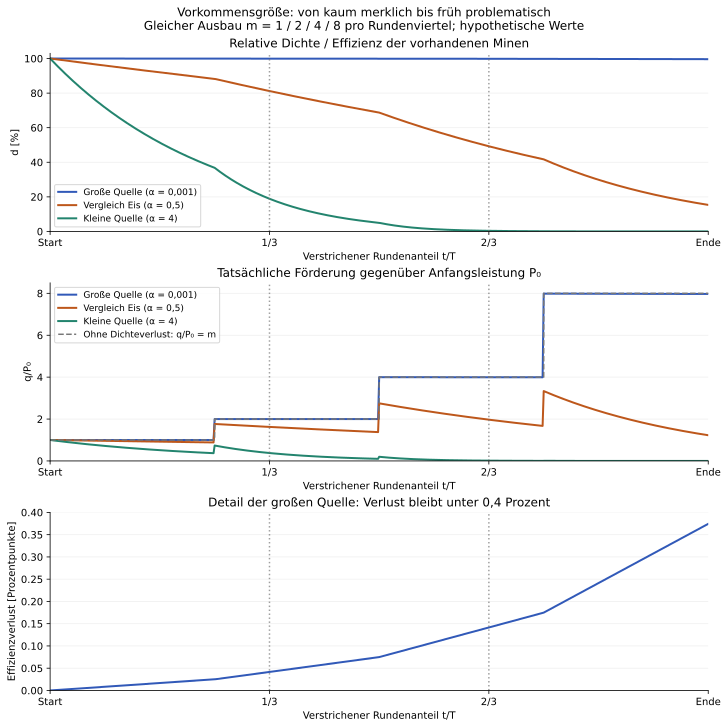
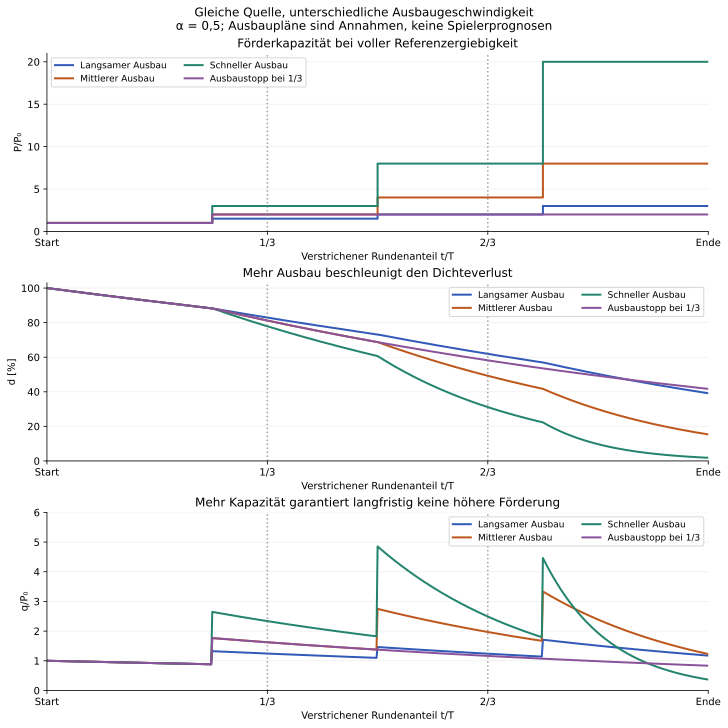
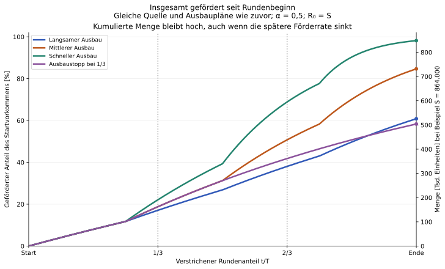
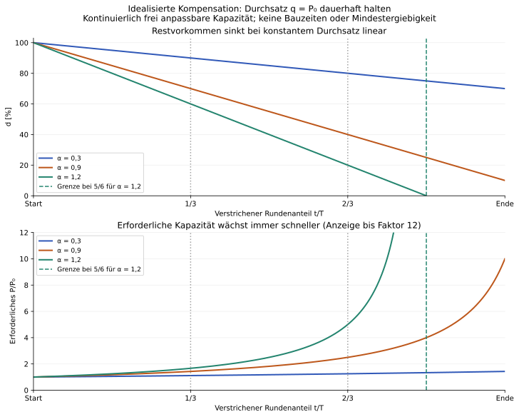

# Ressourcenabbau über eine Runde: Szenarien und Extremfälle

**Stand: 2026-11-08.** Vom Projektinhaber gewünschte Exploration, kein beschlossenes Balancing. Für Eisen soll der Förderverlust möglicherweise praktisch vernachlässigbar bleiben. Für Eis ist die gewünschte Richtung: ungefähr ab dem ersten Rundendrittel spürbar, ab dem zweiten Drittel ein echtes strategisches Problem. Dies sind vorläufige zeitliche Zielmarken; was „spürbar“ und „Problem“ konkret bedeutet, bleibt zu operationalisieren.

Die [mathematische Grundlage](continuous-ice-extraction.md) erklärt Parameter, allgemeine Integralform und einfache Abschnittsformel. Hier untersuchen wir, welche Kurven dieses Modell unter unterschiedlichen Annahmen erzeugt. Es ist keine Simulation der gesamten Wirtschaft und keine Prognose realen Spielerverhaltens.

## Vergleichsrahmen ohne vorweggenommene Rundendauer

Wir normieren die Zeit als x = t/T. T ist eine noch festzulegende Rundendauer; die Quelle startet für diese Beispiele bei R₀ = S und d₀ = 1. Alle Minen nutzen diese Quelle, sind versorgt und können ihre Förderkapazität einsetzen. Eine Mindestergiebigkeit, alternative Quellen und Lager-/Verbraucherrückwirkungen sind in den Charts **nicht** enthalten. Gerade die Kurven nahe null zeigen daher die Grenzen des Grundmodells und kein akzeptiertes Verhalten des Spiels.

| Größe | Bedeutung |
| --- | --- |
| x = t/T | Verstrichener Anteil der Runde, 0 bis 1 |
| P₀ | Anfangskapazität bei voller Referenzergiebigkeit, beispielsweise in Eis/h |
| m(x) = P(t)/P₀ | Ausbauverlauf als Vielfaches dieser Kapazität |
| α = P₀T/S | Dimensionslose Abbauintensität; großes S bedeutet kleines α |
| J(x) = ∫₀ˣ m(v) dv | Dimensionslose kumulierte Referenzförderung |

Damit gilt für die vorgegebenen Ausbaupläne:

$$
d(x)=e^{-\alpha J(x)},\qquad \frac{q(x)}{P_0}=m(x)e^{-\alpha J(x)}.
$$

Die Pläne sind stückweise konstant: Jeder Kapazitätssprung steht für angenommene Fertigstellungen oder Upgrades. Zwischen diesen Ereignissen berechnen wir den Abbau direkt mit der einfachen Abschnittsformel. Die Chart-Stützpunkte dienen nur der Darstellung. **Kapazitätsfaktor ist nicht automatisch Minenzahl:** Unterschiedliche Minentypen, Stufen und Technologien können ebenfalls zu m beitragen.

## Leseschlüssel: Warum die Kurven deutliche Knicke zeigen

**Darstellungsannahme, keine Ausbauprognose:** Die Pläne bündeln den gesamten Ausbau in nur drei großen Kapazitätsänderungen bei 1/4, 1/2 und 3/4 der Runde. Beim schnellen Plan steigt P/P₀ beispielsweise zur Rundenhälfte auf einen Schlag von 3 auf 8. Das steht für ein angenommenes Ausbaupaket; es bedeutet weder eine einzelne Mine mit dieser Wirkung noch, dass Spieler nur dreimal pro Runde bauen.

| Dargestellte Größe | Wirkung einer solchen Fertigstellung |
| --- | --- |
| Referenzkapazität P | Springt auf den neu angenommenen Wert. |
| Momentane Förderrate q | Springt ebenfalls, weil bei derselben verbleibenden Dichte mehr Kapazität arbeitet. Danach bremst der weitere Dichteverlust die Förderung wieder. |
| Restvorkommen R und relative Dichte d | Bleiben stetig; ihre Abnahme wird unmittelbar nach dem Ausbau schneller. Die Kurven haben einen Knick, keinen Mengensprung. |
| Kumulierte Förderung A | Bleibt stetig; nur die Steigung nimmt mit q sprunghaft zu. Bereits geförderte Mengen werden durch den Ausbau nicht rückwirkend erhöht. |

Die gestrichelten senkrechten Linien markieren dagegen **Rundendrittel als Vergleichszeitpunkte**, keine Fertigstellungen. Die auffälligen Knicke liegen an den Viertelgrenzen der angenommenen Ausbaupakete.

**Zweck der Visualisierung:** Sie soll die Zusammenhänge zwischen Ausbau, beschleunigtem Dichteverlust, späterer Förderrate und kumuliertem Gesamtertrag sichtbar machen. Szenario A variiert dafür die Quellengröße, Szenario B den Ausbauplan und Szenario C zeigt einen idealisierten Kompensationsbedarf. Die wenigen großen Änderungen machen diese Wirkungen erkennbar, überzeichnen aber die Größe einzelner Fertigstellungseffekte gegenüber einem kleinteiligen Ausbau. Auch Zeitpunkt und Bündelung beeinflussen den Abbau und Gesamtertrag; diese Pläne sind keine ergebnisgleiche Zusammenfassung eines bereits bekannten realen Bauverlaufs.

**Arbeitshypothese des Projektinhabers (2026-11-08):** Bei angenommener Rundendauer von einem Jahr könnte ein Spieler ungefähr 50–100 Eisminen bauen, vermutlich eher am oberen Ende. Dies ist eine erste Einschätzung, keine aus dem Gebäudemodell hergeleitete Zahl und keine festgelegte Rundendauer. Verteilung auf Kolonien, Minentypen und Technologien sowie die Unterscheidung zwischen über die Runde gebauten und gleichzeitig betriebenen Minen bleiben zu klären. Diese Einschätzung ist in den vorhandenen Charts noch nicht als eigener Ausbauplan umgesetzt.

Bei vielen verteilten Fertigstellungen wären mehr, meist kleinere Knicke zu erwarten. Vor allem bei gleichartigen Minen wird der relative Zuwachs einer einzelnen zusätzlichen Mine mit wachsendem Bestand kleiner. Neue Minentypen oder Technologien können weiterhin größere Änderungen verursachen. Wie viele Minen plausibel sind und wann sie fertig werden, lässt sich erst mit Gebäudeangebot, Förderleistung, Infrastrukturbedarf, konkurrierenden Bauvorhaben und Bauzeiten belastbarer bestimmen. Bis dahin zeigen die Charts hypothetische Modellreaktionen; sie belegen weder erreichbare Strategien noch die gewünschte Spielerwirkung.

## Szenario A: Sehr große, mittlere und sehr kleine Quelle

Für alle drei Kurven gilt derselbe Ausbauplan:

| Rundenanteil | 0 bis 1/4 | 1/4 bis 1/2 | 1/2 bis 3/4 | 3/4 bis Ende |
| --- | ---: | ---: | ---: | ---: |
| m = P/P₀ | 1 | 2 | 4 | 8 |

Die Ereignisse liegen bewusst in Vierteln, während die Vergleichsmarken in Dritteln liegen. Die Zielzeitpunkte ergeben sich also nicht aus einem dort gesetzten Kapazitätssprung.



| Hypothetische Parametrisierung | α | Dichte bei 1/3 | Dichte bei 2/3 | Dichte am Ende |
| --- | ---: | ---: | ---: | ---: |
| Große Quelle; möglicher Eisen-Vergleich | 0,001 | 99,96 % | 99,86 % | 99,63 % |
| Mittlere Quelle; Eis-Untersuchung | 0,5 | 81,19 % | 49,25 % | 15,34 % |
| Kleine Quelle; zu frühe starke Verknappung | 4 | 18,89 % | 0,35 % | 0,000031 % |

Im mittleren Beispiel steigt der rechnerische Kapazitätsbedarf für denselben Durchsatz gegenüber einer unverminderten Quelle auf etwa **Faktor 1,23 bei einem Drittel**, **2,03 bei zwei Dritteln** und **6,52 am Ende**. Das sind jeweils 1/d am betrachteten Zustand: ein momentaner Vergleich, kein bereits simulierter Kompensationsausbau. Zusätzlicher tatsächlicher Ausbau würde den späteren Dichteverlauf wiederum ändern.

**Interpretation:** Das Modell kann einen fast unsichtbaren Verlust für eine große Quelle und einen zunehmend relevanten Effizienzverlust für Eis erzeugen. Der Kurvenverlauf ist aber noch kein Nachweis für die gewünschte Spielerwirkung. Tatsächliche Förderung kann dank Ausbau steigen, während die Effizienz fällt. Für einen Versorgungsmangel braucht es zusätzlich einen Bedarfspfad und die Entwicklung der Vorräte.

Beim großen Vorkommen liegt der Verlust in diesem Ausbauplan am Ende unter 0,4 Prozentpunkten. „Praktisch vernachlässigbar“ muss später gegen Anzeigeauflösung und tatsächliche wirtschaftliche Wirkung geprüft werden. Bei stärkerem Ausbau ist derselbe Wert nicht garantiert. Bei der kleinen Quelle führt das Grundmodell fast zu null; die geplante Mindestergiebigkeit muss diesen Bereich später anders behandeln.

## Szenario B: Gleiche Quelle, verschiedene Ausbaupläne

Alle Kurven verwenden α = 0,5. Nur der vorgegebene Ausbau wird verändert:

| Plan | Erstes Viertel | Zweites Viertel | Drittes Viertel | Letztes Viertel |
| --- | ---: | ---: | ---: | ---: |
| Langsam | 1 | 1,5 | 2 | 3 |
| Mittel | 1 | 2 | 4 | 8 |
| Schnell | 1 | 3 | 8 | 20 |
| Ausbaustopp ab 1/3 | 1 | 2 | 2 | 2 |

Beim Ausbaustopp wird bis 1/3 der mittlere Plan verfolgt. Die letzte Fertigstellung war bei 1/4; danach werden die ab 1/2 geplanten Ausbauten nicht mehr umgesetzt. Bereits betriebene Minen laufen weiter. Dies modelliert einen Ausbaustopp, keine Stilllegung und keine vollständige Abwesenheitssimulation.



| Plan | Dichte bei 1/3 | Dichte bei 2/3 | Dichte am Ende | Förderung am Ende in P₀ |
| --- | ---: | ---: | ---: | ---: |
| Langsam | 82,90 % | 61,93 % | 39,16 % | 1,175 |
| Mittel | 81,19 % | 49,25 % | 15,34 % | 1,227 |
| Schnell | 77,88 % | 31,14 % | 1,83 % | 0,366 |
| Ausbaustopp | 81,19 % | 58,18 % | 41,69 % | 0,834 |

**Befund:** Im schnellen Plan sinkt die Förderung am Rundenende trotz zwanzigfacher Referenzkapazität unter die Anfangsförderung. Der langsamere Ausbau liefert zu diesem Zeitpunkt mehr, obwohl er weniger Kapazität hat. Die momentane Rate allein sagt nicht, welcher Spieler bis dahin insgesamt mehr gefördert oder wirtschaftlich mehr erreicht hat. Die kumulierte Förderung wird im folgenden Chart separat betrachtet. Ein günstigerer Endwert der Förderrate ist kein automatischer Beleg für eine bessere Strategie.

Daraus folgt ein Balancingrisiko: Ein für den mittleren Plan passend dimensioniertes Vorkommen kann bei starkem Ausbau zu früh problematisch werden. Ob dies erwünschter Raubbau-Druck oder eine Bestrafung aktiver Spieler ist, muss über erreichbare Gegenmaßnahmen, Informationsqualität und konkrete Wirtschaftsverläufe bewertet werden. Eine vom Kalendertag allein bestimmte Verknappung wäre eine andere Mechanik als abbauabhängige Ergiebigkeit.

### Kumulierte Förderung: Wie viel wurde insgesamt gewonnen?

Die momentane Rate q beantwortet „Wie viel pro Stunde wird jetzt gefördert?“. Die kumulierte Menge A beantwortet „Wie viel wurde seit Rundenbeginn insgesamt aus der Quelle gewonnen?“. Unter denselben Annahmen wie in Szenario B gilt mit R₀ = S:

$$
A(t)=\int_0^t q(u)\,du=S-R(t),\qquad
\frac{A(x)}{S}=1-e^{-\alpha J(x)}=1-d(x).
$$

Der Chart zeigt diese Menge über die ganze Runde für die vier unveränderten Ausbaupläne. Die linke Achse gibt den geförderten Anteil des ursprünglichen Vorkommens an. Die rechte Achse übersetzt exakt dieselben Kurven in Tausend Einheiten für das bereits verwendete **Skalierungsbeispiel S = 864.000 Einheiten** (T = 180 Tage, P₀ = 100 Einheiten/h, α = 0,5). Die Rundendauer ist weiterhin keine Festlegung.

**Lesehinweis:** Die Knicke bei 1/4, 1/2 und 3/4 stammen aus den grob gebündelten Ausbaupaketen. Die kumulierte Menge springt dort nicht; ihre Steigung ändert sich. Einzelne Minenfertigstellungen sind in diesen Plänen nicht aufgelöst.



| Plan | Bis 1/3 gefördert, Anteil von S | Bis 2/3 gefördert, Anteil von S | Bis Rundenende gefördert, Anteil von S | Gesamtmenge bei Beispiel S = 864.000 |
| --- | ---: | ---: | ---: | ---: |
| Langsam | 17,10 % | 38,07 % | 60,84 % | 525.652,74 |
| Mittel | 18,81 % | 50,75 % | 84,66 % | 731.501,31 |
| Schnell | 22,12 % | 68,86 % | 98,17 % | 848.175,29 |
| Ausbaustopp | 18,81 % | 41,82 % | 58,31 % | 503.831,21 |

**Befund:** Der schnelle Ausbau führt in diesen Beispielen bei der Gesamtmenge, obwohl seine momentane Rate am Rundenende niedriger ist. Frühe Mehrförderung bleibt Teil des Gesamtertrags. Sinkt die spätere Rate, wächst die kumulierte Menge langsamer weiter; sie sinkt dadurch nicht. Am Minenbauabschluss bleibt A stetig, während sich ihre Steigung mit q ändern kann. An der Obergrenze S flacht die Kurve zunehmend ab: Dieses Grundmodell liefert aus einer einzelnen endlichen Quelle insgesamt höchstens deren ursprüngliche Menge.

**Eigenschaft des Modells:** Bei gleichem S, gleichem Anfangsvorkommen und demselben proportionalen Gesetz wächst A mit der kumulierten Referenzförderung ∫P du. Hat ein Ausbauplan zu jedem Zeitpunkt mindestens so viel P wie ein anderer, kann er bei der kumulierten Bruttoförderung nicht zurückfallen. Genau so sind schneller, mittlerer und langsamer Plan hier geordnet. Der Ausbaustopp ist gegenüber dem langsamen Plan nicht durchgehend nach P geordnet; entsprechend können sich ihre kumulierten Kurven kreuzen. Eine niedrigere späte Förderrate ist also kein Widerspruch zu einer höheren Gesamtförderung. Bei anders verteilten Ausbauzeitpunkten entscheidet die bis dahin aufsummierte Referenzförderung, nicht die zuletzt vorhandene Kapazität.

**Abgrenzung:** A ist Bruttoförderung aus der Quelle, weder Lagerbestand noch wirtschaftlicher Nettogewinn. Bereits verbrauchtes oder wegen Lagergrenzen verfallenes Material zählt zur geförderten Menge. Baukosten und verdrängte Bauzeit werden nicht abgezogen; sie gehören zur noch offenen Bewertung der Strategie. Ein Speicherbestand könnte fallen, obwohl A weiter steigt. Die Rangfolge ist außerdem keine Aussage für andere Fördergesetze, Mindestergiebigkeit oder mehrere neu erschlossene Quellen.

## Szenario C: Durchsatz trotz Verlust konstant halten

Ein weiterer Extremfall fragt: Wie viel Kapazität wäre nötig, um q = P₀ unverändert zu liefern? Für diese Gedankenrechnung darf der Spieler Kapazität jederzeit kontinuierlich und ohne Kosten oder Bauzeit anpassen. Dies ist eine idealisierte Anforderungskurve, kein umsetzbarer Bauplan.

Solange der Durchsatz vollständig gedeckt wird und keine Mindestergiebigkeit greift, gilt:

$$
R(t)=S-P_0t,\qquad d(x)=1-\alpha x,\qquad
\frac{P_{\mathrm{erforderlich}}(x)}{P_0}=\frac{1}{1-\alpha x},\quad \alpha x<1.
$$



Bei α = 0,9 braucht man zur Hälfte der Runde Faktor 1,82, bei zwei Dritteln Faktor 2,5 und am Ende Faktor 10 an Kapazität. Bei α = 1,2 wäre die endliche Quelle bei x = 5/6 aufgebraucht, wenn der Durchsatz bis dahin gehalten werden könnte. Schon davor wächst die nötige Kapazität unbegrenzt; ein realer Ausbau stößt früher an Grenzen. Der Chart zeigt den Kapazitätsbedarf nur bis Faktor 12 und setzt die Lösung jenseits der Erschöpfungsgrenze nicht fort.

Das widerspricht nicht der asymptotischen Annäherung bei konstantem P: Hier wird P gerade ständig erhöht und würde gegen unendlich gehen. Die idealisierte Annahme ist am Grenzzeitpunkt nicht mehr erfüllbar.

**Offene Verbindung zum Spiel:** Minentypen, Baukosten, Technologien und Bauzeiten bestimmen, welche Kapazität erreichbar ist und wie viel Bauzeit sie verdrängt. Man kann aus diesen Charts weder die Zahl notwendiger Minen noch die verlorene Forschungs- oder Militärentwicklung ablesen. Steigender tatsächlicher Bedarf würde den Kompensationsdruck zusätzlich verändern.

## Aus Zielmarken Parameter ableiten

Für einen angenommenen Ausbauplan lässt sich S aus einer gewünschten relativen Dichte d* bei x* berechnen:

$$
\alpha=\frac{-\ln d_{\ast}}{J(x_{\ast})},\qquad
S=\frac{P_0T\,J(x_{\ast})}{-\ln d_{\ast}}.
$$

Dies gilt hier für d₀ = 1, 0 < d* < 1 und positive Beanspruchung J(x*). Bei anderen Anfangsdichten tritt d*/d₀ in den Logarithmus ein. Nur ein Zielpunkt bestimmt α. **Zwei frei gewählte Zielpunkte sind nicht automatisch mit derselben Quelle und demselben Ausbauplan erreichbar:** Es muss gelten

$$
\frac{-\ln d_1}{J(x_1)}=\frac{-\ln d_2}{J(x_2)}.
$$

Beispielsweise wären 80 Prozent Dichte bei einem Drittel und 50 Prozent bei zwei Dritteln im mittleren Plan keine exakt zusammenpassenden Vorgaben: Sie erfordern α ≈ 0,536 beziehungsweise α ≈ 0,489. Das Vergleichsbeispiel α = 0,5 liegt nahe beiden Werten. Die Prozentzahlen sind Illustrationen, keine bereits beschlossenen Bedeutungen von „spürbar“ und „Problem“.

### Übertragung in reale Tage: reine Skalierungsbeispiele

Mit dem gleichen normierten Ausbauplan und α = 0,5 ergeben sich bei der willkürlich gesetzten Anfangskapazität P₀ = 100 Einheiten/h:

| Angenommene Rundendauer T | Erstes Drittel | Zweites Drittel | Referenzmenge S |
| --- | ---: | ---: | ---: |
| 90 Tage | Tag 30 | Tag 60 | 432.000 Einheiten |
| 180 Tage | Tag 60 | Tag 120 | 864.000 Einheiten |
| 360 Tage | Tag 120 | Tag 240 | 1.728.000 Einheiten |

Diese Skalierung hält den Ausbauplan relativ zur Runde fest. Sie behauptet nicht, dass Spieler in einer halb so langen Runde dieselben Technologien und Minen erreichen. Bei unveränderten realen Bauzeiten ist der Ausbauplan neu zu bestimmen. S ist weiterhin die feste Quellenreferenz, keine nach jedem Ausbau neu gesetzte Menge.

## Noch zu klärende Balancing-Annahmen

| Frage | Warum sie den Verlauf verändert |
| --- | --- |
| Wie lange dauert eine Runde, und was bedeutet Rundenende? | Bestimmt die absolute Zeitskala und das angestrebte Tempo. |
| Wie entwickeln sich Minentypen, Technologien und Bauzeiten? | Bestimmt den plausiblen Kapazitätspfad statt frei gewählter Sprünge. |
| Wie viel Kapazität bauen langsame, mittlere und sehr aktive Spieler? | Bestimmt die Bandbreite, für die das Balancing funktionieren muss. |
| Wie entwickeln sich Eis-/Wasserbedarf und Vorräte? | Erst damit werden tatsächliche Versorgungslücken und Warnzeiten sichtbar. |
| Wann werden andere Quellen erschlossen, und wie wirkt die Mindestergiebigkeit? | Bestimmt Gegenmaßnahmen und den späteren Kurvenast. |
| Gelten Ziele für Rundenalter oder Kolonie-/Spieleralter? | Späteinsteiger und neue Kolonien dürfen nicht versehentlich dem falschen Zeithorizont zugeordnet werden. |

**Vorschlag für überprüfbare Wirkungskriterien:** Ab ungefähr 1/3 muss Kompensation einen merklichen Anteil der verfügbaren Bauzeit beanspruchen. Ab ungefähr 2/3 wird ohne Quellenwechsel oder erheblichen Verzicht auf andere Entwicklung ein Versorgungsdefizit absehbar. Schwellen, Vorwarnzeit und erfasste Spielertypen sind gemeinsam festzulegen. Die Charts allein bestätigen diese Wirkung noch nicht.

Für die nächste Balancingrunde brauchen wir deshalb mindestens einen plausiblen Ausbaupfad mit Bauzeiten und einen Bedarfspfad. Zunächst Bandbreiten verwenden; Unsicherheit über Spielerverhalten nicht durch einen einzelnen scheinbar präzisen Minenzahlwert verdecken.

## To-do: Charts für konkrete Balancing-Iterationen

- [ ] Die Charts als separate Balancing-Auswertung für konkrete Gebäude- und Planetenwerte generieren, sobald wir diese Werte balancen oder eine erste Iteration mit Ad-hoc-Werten beginnen. Vorläufige Werte müssen dafür nicht vollständig abgestimmt sein; sie werden ausdrücklich als Annahmen gekennzeichnet. Je Iteration die verwendeten Gebäudeparameter (Förderleistung, Bauzeiten und Betriebsbedarf), Planetenparameter (Vorkommen und Dichte), Rundendauer und Ausbaupläne mitführen. Dichte, momentane Förderrate und kumulierte Förderung für mehrere Ausbauverläufe als eigene SVGs ausgeben. Die Parameterstände und Annahmen zusammen mit den Charts dokumentieren, damit sich die Ergebnisse reproduzieren und zwischen Iterationen vergleichen lassen. Dabei kleinteilig verteilte Fertigstellungen betrachten; die bisherigen großen Ausbaupakete dienen nur der Erklärung der Modellzusammenhänge.

## Reproduktion und geprüfter Umfang

```sh
python -m pip install matplotlib
python doc/game-design/tools/plot_extraction_scenarios.py
```

Das [Hilfsskript](tools/plot_extraction_scenarios.py) erzeugt die vier SVG-Charts und lokale PNG-Vorschauen. Es prüft die Gleichheit von Integralform, Produkten der Abschnittsformeln und zusätzlich unterteilten Abschnitten für alle Ausbaupläne und Abbauintensitäten. Ein linearer zeitlicher Leistungsanstieg sowie die Kompensationsgleichung werden separat mathematisch geprüft. Die kumulierte Förderung wird zusätzlich gegen die Summe der exakten Abschnittsförderungen sowie auf Monotonie und Mengenbilanz geprüft. Keine Aussage über Laufzeit, Java-Engine oder die vollständige Wirtschaft ist damit getestet.
