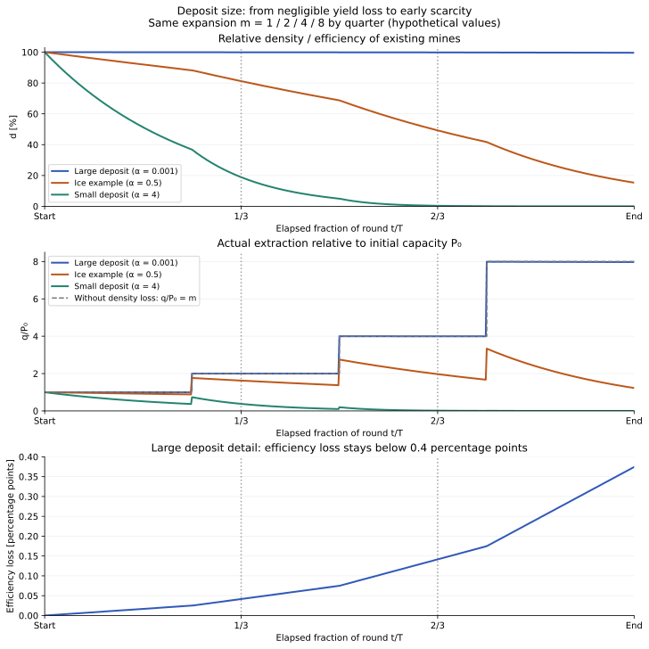
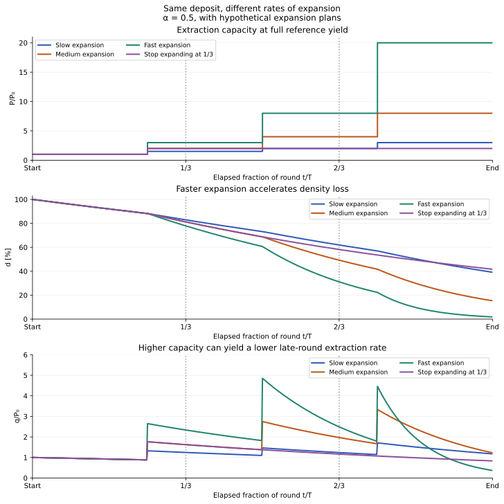
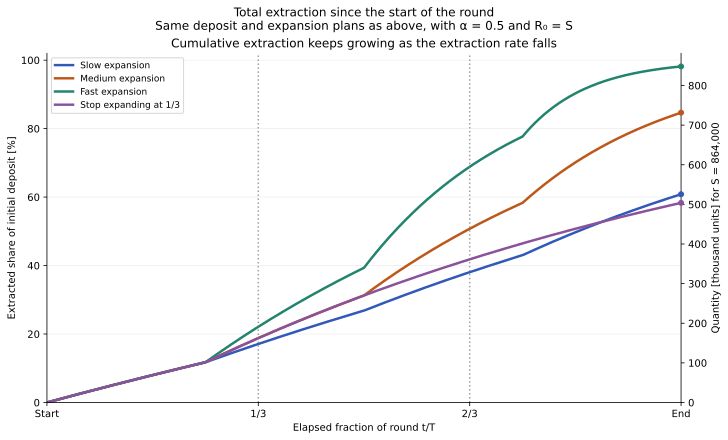
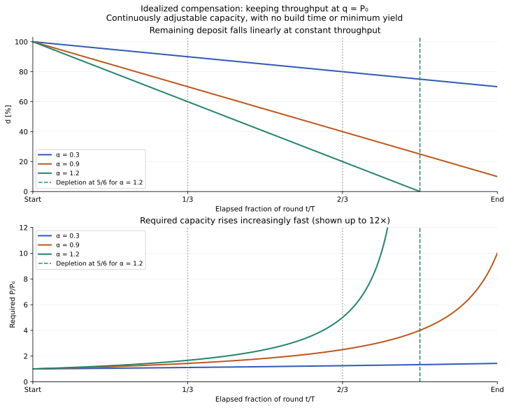

<a name="ressourcenabbau-über-eine-runde-szenarien-und-extremfälle"></a>

# Resource Extraction Over a Round: Scenarios and Extreme Cases

**Status as of 2026-11-08.** The project owner requested this exploration. Balancing remains open. For iron, the loss of yield might remain negligible in practice. For ice, the desired direction is for the loss to become noticeable around the first third of the round and a genuine strategic problem around the second third. These timing targets are preliminary. What counts as “noticeable” or a “problem” still needs measurable criteria.

The [mathematical model](continuous-ice-extraction.md) explains the parameters, general integral form, and simple interval formula. Here we explore how the curves respond to different assumptions. The charts model extraction only and make no prediction about actual player behavior.

<a name="vergleichsrahmen-ohne-vorweggenommene-rundendauer"></a>

## Comparison Without a Fixed Round Length

Normalize time as x = t/T for a round length T still to be defined. For these examples, the deposit starts at R₀ = S and d₀ = 1. All mines use this deposit, are supplied, and can use their extraction capacity. The charts omit minimum yield, alternative deposits, and feedback from storage and consumers. Curves near zero illustrate where the base model falls short of the intended game behavior.

| Quantity | Meaning |
| --- | --- |
| x = t/T | Elapsed fraction of the round, 0 to 1 |
| P₀ | Initial capacity at full reference yield, for example in ice/h |
| m(x) = P(t)/P₀ | Expansion path as a multiple of that capacity |
| α = P₀T/S | Dimensionless extraction intensity. Larger S means smaller α. |
| J(x) = ∫₀ˣ m(v) dv | Dimensionless cumulative reference extraction |

For the predefined expansion plans:

$$
d(x)=e^{-\alpha J(x)},\qquad \frac{q(x)}{P_0}=m(x)e^{-\alpha J(x)}.
$$

Plans are piecewise constant. Each jump in capacity represents assumed completions or upgrades. Between events, compute extraction directly with the simple interval formula. Sampling points serve only the charts. **The capacity multiplier can include mine types, levels, and technologies** as well as mine count.

<a name="leseschlüssel-warum-die-kurven-deutliche-knicke-zeigen"></a>

## Reading the Charts: Why the Curves Have Pronounced Kinks

**Plotting assumption.** The plans group all expansion into three large capacity changes at 1/4, 1/2, and 3/4 of the round. In the fast plan, for example, P/P₀ rises from 3 to 8 at mid-round. This represents an assumed batch of expansions. Actual players could build more often, in smaller increments.

| Quantity shown | Effect of a completion |
| --- | --- |
| Reference capacity P | Jumps to the newly assumed value. |
| Instantaneous extraction rate q | Also jumps because more capacity operates at the same remaining density. Further density loss then slows extraction again. |
| Remaining deposit R and relative density d | Remain continuous and decline faster immediately after the expansion. The slopes change without jumps in quantity. |
| Cumulative extraction A | Remains continuous. Its slope rises abruptly with q. Expansion leaves quantities already extracted intact. |

The vertical dashed lines mark **thirds of the round as comparison points**. The pronounced kinks lie at the quarter boundaries of the assumed expansions.

**Purpose of the charts.** Show how expansion, faster density decline, later extraction rates, and cumulative output interact. Scenario A varies deposit size, B varies expansion plans, and C shows idealized compensation. A few large changes make the effects visible and exaggerate individual completions compared with gradual expansion. Timing and grouping also affect depletion and total yield, so the plans do not reproduce a known sequence of actual construction.

**Project owner's working hypothesis (2026-11-08).** In an assumed one-year round, a player might build around 50–100 ice mines, probably toward the high end. This preliminary estimate is independent of the building model, and round length remains open. Distribution across colonies, mine types, and technologies remains open, as does the distinction between mines built over a round and mines operating at the same time. The current charts have no expansion plan based on this estimate.

Many staggered completions would create more and usually smaller kinks. For similar mines, an extra mine's relative contribution falls as the installed base grows. New mine types or technologies can still have larger effects. Plausible mine counts and timing depend on available buildings, output, infrastructure requirements, competing construction, and build times. For now, the charts show hypothetical model responses. Feasible strategies and the intended player experience still need validation.

<a name="szenario-a-sehr-große-mittlere-und-sehr-kleine-quelle"></a>

## Scenario A: Very Large, Medium, and Very Small Deposits

All three curves use the same expansion plan:

| Fraction of the round | 0 to 1/4 | 1/4 to 1/2 | 1/2 to 3/4 | 3/4 to end |
| --- | ---: | ---: | ---: | ---: |
| m = P/P₀ | 1 | 2 | 4 | 8 |

The capacity changes are deliberately at quarter boundaries and the comparison markers at thirds, so the target times do not coincide with a capacity jump.



| Hypothetical parameters | α | Density at 1/3 | Density at 2/3 | Final density |
| --- | ---: | ---: | ---: | ---: |
| Large deposit, possible iron comparison | 0.001 | 99.96% | 99.86% | 99.63% |
| Medium deposit, ice example | 0.5 | 81.19% | 49.25% | 15.34% |
| Small deposit, severe scarcity too early | 4 | 18.89% | 0.35% | 0.000031% |

In the middle example, matching the throughput of an undepleted deposit takes around **1.23 times the capacity at one-third**, **2.03 times at two-thirds**, and **6.52 times at the end**. These are instantaneous comparisons using 1/d at each point. Adding actual capacity would itself change later density.

**Interpretation.** The model can produce a nearly invisible yield loss for a large deposit and an increasingly important efficiency loss for ice. The intended player experience still needs testing. Actual extraction can increase through expansion even as efficiency falls. A shortage also depends on demand and the evolution of stocks.

With the large deposit and this plan, the final loss is below 0.4 percentage points. Evaluate whether that is negligible against display resolution and economic impact. Higher expansion can raise the loss. For the small deposit, the base model approaches zero, a region the planned minimum yield will need to handle differently.

<a name="szenario-b-gleiche-quelle-verschiedene-ausbaupläne"></a>

## Scenario B: Same Deposit, Different Expansion Plans

All curves use α = 0.5 and vary only the predefined expansion:

| Plan | First quarter | Second quarter | Third quarter | Last quarter |
| --- | ---: | ---: | ---: | ---: |
| Slow | 1 | 1.5 | 2 | 3 |
| Medium | 1 | 2 | 4 | 8 |
| Fast | 1 | 3 | 8 | 20 |
| Stop expanding at 1/3 | 1 | 2 | 2 | 2 |

The stopped plan follows the medium plan until 1/3. The last completion was at 1/4. Expansion scheduled from 1/2 onward does not occur. Existing mines keep running. Broader effects of player absence and mine shutdowns are outside this scenario.



| Plan | Density at 1/3 | Density at 2/3 | Final density | Final extraction in units of P₀ |
| --- | ---: | ---: | ---: | ---: |
| Slow | 82.90% | 61.93% | 39.16% | 1.175 |
| Medium | 81.19% | 49.25% | 15.34% | 1.227 |
| Fast | 77.88% | 31.14% | 1.83% | 0.366 |
| Stop expanding | 81.19% | 58.18% | 41.69% | 0.834 |

**Observation.** The fast plan ends below its initial extraction rate despite twenty times the reference capacity. Slower expansion yields more at that point despite having less capacity. The instantaneous rate alone does not establish which player extracted more in total or developed a stronger economy. The next chart compares cumulative extraction. A better final rate alone does not establish a better strategy.

A deposit sized for the medium plan could become a problem too early under fast expansion. Whether this rewards restraint or penalizes active players depends on reachable responses, quality of information, and actual economic trajectories. Scarcity tied only to the calendar would behave differently from extraction-driven depletion.

<a name="kumulierte-förderung-wie-viel-wurde-insgesamt-gewonnen"></a>

### Cumulative Extraction: How Much Has Been Extracted in Total?

The instantaneous rate q gives current extraction per hour. Cumulative A gives total extraction from the deposit since the start of the round. With the assumptions in scenario B and R₀ = S:

$$
A(t)=\int_0^t q(u)\,du=S-R(t),\qquad
\frac{A(x)}{S}=1-e^{-\alpha J(x)}=1-d(x).
$$

The chart shows the amount over a whole round for the same four expansion plans. The left axis gives the extracted share of the original deposit. The right axis expresses the same curves in thousands of units for the **scaling example S = 864,000 units** (T = 180 days, P₀ = 100 units/h, α = 0.5). Round length remains open.

**Reading the chart.** Kinks at 1/4, 1/2, and 3/4 come from the grouped expansions. The slope changes while the cumulative quantity stays continuous. Individual mine completions are not resolved.



| Plan | Extracted by 1/3, share of S | Extracted by 2/3, share of S | Extracted by round end, share of S | Total for example S = 864,000 |
| --- | ---: | ---: | ---: | ---: |
| Slow | 17.10% | 38.07% | 60.84% | 525,652.74 |
| Medium | 18.81% | 50.75% | 84.66% | 731,501.31 |
| Fast | 22.12% | 68.86% | 98.17% | 848,175.29 |
| Stop expanding | 18.81% | 41.82% | 58.31% | 503,831.21 |

**Observation.** Fast expansion leads in total quantity despite a lower instantaneous rate at round end. Extra early extraction remains in the total. A declining rate slows cumulative growth without decreasing the total. At mine completion A stays continuous while its slope can change with q. The curve flattens as it approaches S. This base model yields at most the initial quantity from one finite deposit.

**Model property.** Given the same S, initial deposit, and proportional law, A increases with cumulative reference extraction ∫P du. If one plan always has at least as much P as another, its gross cumulative extraction cannot fall behind. The fast, medium, and slow plans are ordered that way here. The stopped and slow plans are not consistently ordered by P, so their cumulative curves can cross. A lower late rate can therefore coexist with higher total extraction. If expansion timings differ, cumulative capacity up to the point of comparison determines the outcome.

**Scope.** A is gross extraction from the deposit. Consumed resources and losses due to storage limits count toward it. Construction costs and displaced build time are not deducted and belong to a separate strategy evaluation. Stocks can fall as A rises. Different extraction laws, minimum yields, or additional deposits may change the ranking.

<a name="szenario-c-durchsatz-trotz-verlust-konstant-halten"></a>

## Scenario C: Maintaining Throughput as Yield Declines

This extreme case asks how much capacity would maintain q = P₀. In the calculation, the player can change capacity continuously, without costs or construction time. The curve describes an idealized capacity requirement.

As long as throughput is fully maintained and no minimum yield applies:

$$
R(t)=S-P_0t,\qquad d(x)=1-\alpha x,\qquad
\frac{P_{\mathrm{required}}(x)}{P_0}=\frac{1}{1-\alpha x},\quad \alpha x<1.
$$



For α = 0.9, the required capacity multipliers are 1.82 at mid-round, 2.5 at two-thirds, and 10 at round end. For α = 1.2, the finite deposit would run out at x = 5/6 if throughput could be maintained that long. Required capacity grows without bound before that point, and real expansion would hit its limits sooner. The chart caps the display at factor 12 and stops at the depletion boundary.

The asymptotic curve for constant P uses a different capacity path. Here P rises continuously and tends to infinity. The assumption cannot be met at the boundary.

**Connection to gameplay.** Mine types, costs, technologies, and build times determine attainable capacity and displaced construction time. Deriving mine counts or lost research or military development requires those inputs. Growing demand would also change the pressure to compensate.

<a name="aus-zielmarken-parameter-ableiten"></a>

## Deriving Parameters from Targets

For an assumed expansion plan, derive S from a desired relative density d* at x*:

$$
\alpha=\frac{-\ln d_{\ast}}{J(x_{\ast})},\qquad
S=\frac{P_0T\,J(x_{\ast})}{-\ln d_{\ast}}.
$$

This applies to d₀ = 1, 0 < d* < 1, and positive J(x*). With a different initial density use d*/d₀ in the logarithm. A single target fixes α. Two chosen targets can be met by the same deposit and expansion plan only if:

$$
\frac{-\ln d_1}{J(x_1)}=\frac{-\ln d_2}{J(x_2)}.
$$

For example, the medium plan needs α ≈ 0.536 for 80% density at one-third and α ≈ 0.489 for 50% at two-thirds. The comparison value α = 0.5 is close to both. These percentages illustrate the calculation. The meaning of “noticeable” and “problem” remains open.

<a name="übertragung-in-reale-tage-reine-skalierungsbeispiele"></a>

### Conversion to Real Days: Scaling Examples

With the same normalized expansion plan and α = 0.5, choosing an illustrative starting capacity of P₀ = 100 units/h gives:

| Assumed round length T | One-third | Two-thirds | Reference quantity S |
| --- | ---: | ---: | ---: |
| 90 days | Day 30 | Day 60 | 432,000 units |
| 180 days | Day 60 | Day 120 | 864,000 units |
| 360 days | Day 120 | Day 240 | 1,728,000 units |

Scaling fixes the expansion plan relative to the round. If absolute build times stay the same, recalculate the expansion plan for each round length to see what players could build. S stays fixed across expansions.

<a name="noch-zu-klärende-balancing-annahmen"></a>

## Open Balancing Assumptions

| Question | Why it changes the curve |
| --- | --- |
| How long is a round, and what happens at its end? | Determines the absolute time scale and intended pace. |
| How do mine types, technologies, and build times develop? | Determines a plausible capacity path in place of arbitrary jumps. |
| How much capacity do slow, moderate, and highly active players build? | Determines the range that balancing must cover. |
| How do ice and water demand and stocks evolve? | Reveals actual supply gaps and warning times. |
| When do players reach other deposits, and how does minimum yield work? | Determines available responses and the later part of the curve. |
| Do targets apply to round age or colony or player age? | Late entrants and new colonies need the correct reference time. |

**Proposed measurable criteria.** From around one-third, maintaining output takes a noticeable share of available construction time. From around two-thirds, a shortage is foreseeable unless the player changes sources or substantially reduces investment elsewhere. Define thresholds, warning time, and player types together. The charts alone cannot verify these effects.

The next balancing iteration needs at least one plausible expansion path with build times and one demand path. Start with ranges so uncertainty in player behavior stays visible.

<a name="to-do-charts-für-konkrete-balancing-iterationen"></a>

## To-Do: Charts for Specific Balancing Iterations

- [ ] Generate separate balancing charts for concrete building and planet values when balancing them or starting a first iteration with ad hoc values. Preliminary values can be used if explicitly marked as assumptions. Record building parameters (extraction capacity, build times, and operating needs), planet parameters (deposits and density), round length, and expansion plans per iteration. Produce separate SVGs for density, instantaneous extraction rate, and cumulative extraction across several expansion paths. Record parameter versions and assumptions next to the charts so results can be reproduced and compared across iterations. Model staggered completions at a finer scale. The existing large expansion batches illustrate the relationships in the model.

<a name="reproduktion-und-geprüfter-umfang"></a>

## Reproduction and Verification Scope

```sh
python -m pip install matplotlib
python doc/game-design/tools/plot_extraction_scenarios.py
```

The [script](tools/plot_extraction_scenarios.py) generates the four SVGs and local PNG previews. It checks that the integral, products of interval formulas, and further subdivisions agree for all expansion plans and intensities. It checks a linear increase in capacity and the compensation equation separately. It also verifies cumulative extraction against the sum of exact interval yields and checks monotonicity and material balance. Runtime performance, the Java engine, and the full economy are outside these checks.
