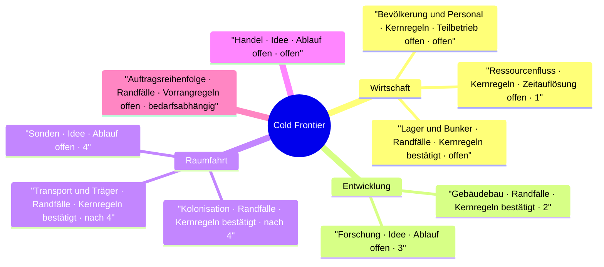

# Projektetappen und Designstand

Eine **Projektetappe** beschreibt einen prüfbaren Entwicklungsstand des gesamten Spiels. Die **erste Ausbaustufe einer Mechanik** beschreibt den einfachsten vorgesehenen Umfang dieser Mechanik, sobald sie eingeführt wird. Ihre Ausarbeitung legt keinen Einführungstermin fest.

## Reihenfolge

| Etappe | Umfang | Prüffall |
| --- | --- | --- |
| 1 · Ressourcensimulation | Ein Planet mit vorgegebenen Anlagen. Produktion und Verbrauch verändern Bestände über die Spielzeit. | Ein Wasserwerk produziert aus Eis und Energie. Bei erschöpftem Eisvorrat endet die Wasserproduktion zum fachlich richtigen Zeitpunkt. |
| 2 · Gebäudebau | Der Spieler setzt Ressourcen ein und verändert durch Fertigstellung eines Gebäudes die Produktion auf demselben Planeten. | Eine neue Mine erhöht ab Fertigstellung die Förderung. Damit entsteht die erste spielbare Schleife aus Produzieren und Investieren. |
| 3 · Forschung | Eine erste Forschung verändert die Wirtschaft oder schaltet ein Gebäude frei. Der Ablauf bleibt auf einem Planeten. | Ein Forschungsabschluss hat eine sichtbare Wirkung auf den weiteren Ausbau. |
| 4 · Sonnensystem und Sonden | Weitere Planeten werden zu Zielen. Eine Sonde sammelt Informationen über einen Zielplaneten. | Eine Sonde liefert Informationen, die später eine Koloniewahl unterstützen können. |

## Erster Zuschnitt für Etappe 1

**Zur Diskussion.** Ein vorbereiteter Planet mit Wasserwerk, 12 Eis, ausreichend Energie und Platz für das erzeugte Wasser. Bei einer Beispielrate von 10 Wasser pro Stunde entstehen bis Minute 36 genau 6 Wasser. Dabei werden 12 Eis und 6 Energie verbraucht. Ab Minute 36 steht die Wasserproduktion still. Das Audit hält den fachlichen Zeitpunkt und den betroffenen Rohstoff fest. Siehe [S12 in der Wirtschaftsdoku](economy.md#s12--eisvorrat-endet-während-der-wasserproduktion).

Mit dieser Kette lassen sich Bestandsänderungen, ein Engpass und die Wirksamkeit eines Ereignisses gemeinsam prüfen. Anlagen und Startbestände kommen aus dem Szenario. Weitere Gebäude, Bevölkerungsdynamik und planetenübergreifende Mechaniken können danach hinzukommen. Zeiteinheit, Rundung und Fortschreibung bleiben offen.

## Mindmap zum Diskussionsstand

Die Äste folgen den Spielsystemen. Jeder Knoten nennt **Diskussionstiefe · Entscheidungsstand · frühesten geplanten Einsatz**. „Kernregeln“ und „Randfälle“ bezeichnen die bisherige Diskussionstiefe. Die Einstufungen sind eine Momentaufnahme der [Wirtschaftsdoku](economy.md) und der [Architekturfrage zur Auftragsreihenfolge](../architecture/command-ordering.md).

Die Etappenzahl am Knoten steht für den ersten vorgesehenen Ausschnitt. Beispielsweise legt Etappe 2 den ersten Gebäudebau nahe. Wann Warteschlangen, Abbruch und weitere Bauregeln dazukommen, bleibt offen.
