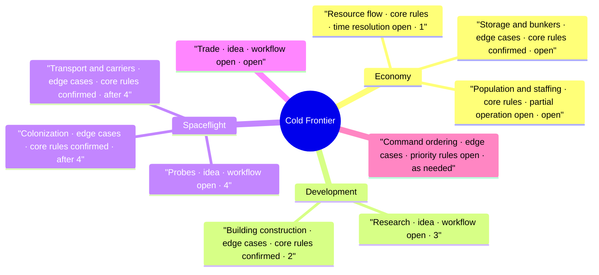

# Project Stages and Design Status

A **project stage** describes a verifiable development milestone for the entire game. The **initial version of a mechanic** describes its simplest intended scope when introduced. Defining that scope leaves the introduction date open.

## Sequence

| Stage | Scope | Test case |
| --- | --- | --- |
| 1 · Resource simulation | One planet with predefined facilities. Production and consumption change stocks over game time. | A water plant uses ice and energy. When the ice stock is depleted, water production stops at the time specified by the rules. |
| 2 · Building construction | The player spends resources and changes production on the same planet by completing a building. | A new mine increases extraction from the time it completes. This creates the first playable loop of production and investment. |
| 3 · Research | An initial research project changes the economy or unlocks a building. The gameplay stays on one planet. | Completing research has a visible effect on further development. |
| 4 · Solar system and probes | Other planets become destinations. A probe gathers information about a target planet. | A probe provides information that can later help choose a colony site. |

## Initial Scope for Stage 1

**For discussion.** The [water production Gherkin scenario](scenarios/water-production.feature) describes the acceptance case for stage 1. The game rule and audit context are documented in [S12 in the economy documentation](economy.md#s12--ice-stock-runs-out-during-water-production).

This chain tests stock changes, a shortage, and the effective time of an event together. The facilities and initial stocks come from the scenario. More buildings, population dynamics, and mechanics spanning multiple planets can follow. The time unit, rounding, and advancement strategy remain open.

Feature files follow the [Gherkin conventions](../gherkin-conventions.md).

## Design Status Mind Map

Branches follow the game systems. Each node gives the **depth of discussion · decision status · earliest planned use**. “Core rules” and “edge cases” indicate how far discussion has progressed. The ratings are a snapshot of the [economy documentation](economy.md) and the [open architecture question on command ordering](../architecture/command-ordering.md).

The stage number marks the earliest planned scope for a node. For example, stage 2 introduces initial building construction. The timing for queues, cancellation, and additional construction rules remains open.
